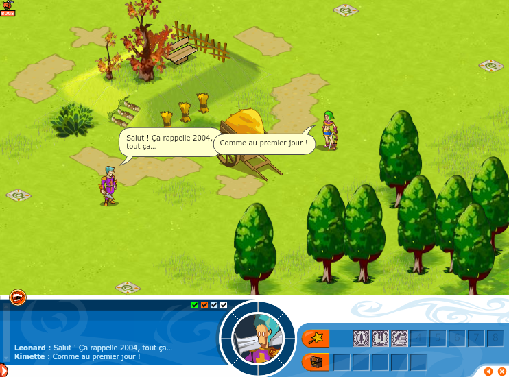

> [!NOTE]
> Unofficial fan project, not affiliated with or endorsed by Ankama. See the [disclaimer](#disclaimer).

<p align="center">
  <a href="https://dofus-classic.com"></a>
</p>

<h3 align="center">Dofus Classic</h3>

<p align="center">
    The Dofus beta of 13 January 2004, playable again in your browser.
    <br />
    <a href="https://dofus-classic.com"><strong>Play now »</strong></a>
    <br />
    <br />
    <a href="#introduction"><strong>Introduction</strong></a> ·
    <a href="#features"><strong>Features</strong></a> ·
    <a href="#tech-stack"><strong>Tech Stack</strong></a> ·
    <a href="#running-locally"><strong>Running Locally</strong></a> ·
    <a href="#contributing"><strong>Contributing</strong></a> ·
    <a href="#credits"><strong>Credits</strong></a>
</p>

<br/>

<p align="center">
  <a href="https://dofus-classic.com">
    
  </a>
</p>

<br/>

## Introduction

Dofus Classic brings back the Dofus **beta 5b** client (13 January 2004, Flash 6 / ActionScript 1), the oldest Dofus
build you can still download, and one that no longer runs anywhere. Its ActionScript was decompiled with JPEXS and
ported to TypeScript on top of a small Flash 6 runtime, with the original graphics, fonts, sounds and music converted
from the SWFs. A lightweight Rust server, written from the documented protocol, brings back the multiplayer.

This beta is a tactical arena game, not yet the MMO: you meet other players on a channel and fight turn-based duels
and team games. Content lost since 2004 (language files, beta maps, login screen, some sounds) is substituted with
clearly labelled material: 2004 maps and early French text from [dofedex](https://github.com/dofera/dofedex), the
ground and object graphics those maps need from later 2004 clients, text from beta screenshots, and authored
placeholders (see `web/public/lang/fr.provenance.json`).

## Features

- **The original client** — the beta's own scripts and interfaces, in French as in 2004, on a 742×550 canvas
- **Accounts and characters** — register from the login screen, create a character from the ten classes (sex and three colours)
- **Multiplayer screen** — channels, chat, friends and smileys
- **Free games** — create or join a game, 1 vs 1 or in teams, with an optional password
- **Random games** — "Jouer seul" matchmaking, or build a team with your friends
- **Turn-based fights** — placement, movement, spells, close combat, critical hits, experience, levels and item rewards
- **Village map** (an addition of this port) — "Rejoindre la carte" puts everyone on the village to walk around and
  chat; the plates at the map edges lead through 90 linked 2004 maps of Amakna
- **Documented** — network protocol, game logic, Flash runtime and asset formats in [`docs/`](./docs)

## Tech Stack

- [TypeScript](https://www.typescriptlang.org/) – the client port
- [Vite](https://vite.dev/) – dev server and build
- [Bun](https://bun.sh/) – runtime, package manager and tests
- [Rust](https://www.rust-lang.org/) ([tokio](https://tokio.rs/), [tokio-tungstenite](https://github.com/snapview/tokio-tungstenite)) – the game server
- [JPEXS Free Flash Decompiler](https://github.com/jindrapetrik/jpexs-decompiler) – decompilation and asset export
- [@napi-rs/canvas](https://github.com/Brooooooklyn/canvas) – headless rendering for tests and the playtest bots
- [Caddy](https://caddyserver.com/) and [Railway](https://railway.com/) – hosting

## Running Locally

Asset tooling needs JPEXS and a Java runtime in `tools/` (gitignored, project-local): unzip
[ffdec_26.3.0.zip](https://github.com/jindrapetrik/jpexs-decompiler/releases/download/version26.3.0/ffdec_26.3.0.zip)
into `tools/ffdec/` and a Temurin 21 JRE ([macOS arm64](https://api.adoptium.net/v3/binary/latest/21/ga/mac/aarch64/jre/hotspot/normal/eclipse))
into `tools/jre/` (`tools/ffdec.sh` expects `tools/jre/Contents/Home/bin/java`). The converted assets are committed,
so this is only needed to regenerate them.

```sh
bun install
bun scripts/assets/convert.ts          # SWF → web/public/assets/swf/
bun scripts/assets-media/extract.ts    # sounds, fonts, bitmaps → web/public/assets/media/
bun scripts/copy-music.ts              # beta music → web/public/assets/media/music/

cd server && cargo run --release       # game server on ws://127.0.0.1:5555
bun run dev                            # website on http://localhost:5173, game on /jouer.html
```

### How to play

Open two tabs at http://localhost:5173/jouer.html (or https://dofus-classic.com/jouer.html), type any account name and
password and click **S'inscrire** the first time (**OK** afterwards), create a character and join the same channel.
Then either:

- **Entraînement** (free games): create a game in one tab, join it from the other;
- **Jouer → Jouer seul** in both tabs: random matchmaking pairs you up (parties of friends via *Constituer une équipe*);
- **Rejoindre la carte** on the character screen: the village map with everyone else who did, to walk around and chat
  (menu → *Aller aux combats* goes to the lobby, *Retour au village* comes back).

Two URL parameters: `/jouer.html?replay=fight` plays a scripted session with no server (login `bo` / `pass`), and
`/jouer.html?server=ws://host:port` points the client at another server.

### Checks

```sh
bun test && bun run typecheck
cd server && cargo test && cargo clippy --all-targets -- -D warnings
bun scripts/playtest.ts                # two headless clients play full games against the real server
```

## Deployment

[dofus-classic.com](https://dofus-classic.com) runs on Railway as two services built from this repository, redeployed
on every push to `main`:

- **web** — the root [`Dockerfile`](./Dockerfile): Vite build served by Caddy. The `VITE_SERVER_URL` build variable is
  the game server address baked into the client (`wss://server.dofus-classic.com`).
- **server** — [`server/Dockerfile`](./server/Dockerfile), with `server/` as the service root. It listens on `$PORT`
  and keeps accounts and characters in `data/runtime/`, on a volume.

## What's in this repo

| Path | What |
|---|---|
| [`dofus-5b/`](./dofus-5b) | The original beta 5b files, read-only |
| [`decompiled/`](./decompiled) | JPEXS export; `decompiled/clean/` has readable names |
| [`web/`](./web) | The website (`index.html`), the game page (`jouer.html`) and the client port (`src/`) |
| [`server/`](./server) | The Rust game server and its data (`server/data/`) |
| [`scripts/`](./scripts) | Asset conversion, server data, website assets and the playtest |
| [`docs/`](./docs) | Protocol, logic, runtime and asset documentation |
| [`vendor/`](./vendor) | Third-party and archived material used for the substitutes |

Start with [`docs/BRIEF.md`](./docs/BRIEF.md), then [`docs/protocol/`](./docs/protocol) (network protocol),
[`docs/logic/`](./docs/logic) (game logic), [`docs/server.md`](./docs/server.md), [`docs/runtime.md`](./docs/runtime.md)
(Flash 6 runtime), [`docs/assets-format.md`](./docs/assets-format.md),
[`docs/content-reconstruction.md`](./docs/content-reconstruction.md) (lost text and what replaced it),
[`docs/missing-data-search.md`](./docs/missing-data-search.md), [`docs/playtest.md`](./docs/playtest.md) and
[`docs/website.md`](./docs/website.md) (the project website, in the look of the 2004 dofus.com).

## Contributing

- [Report a bug](https://github.com/LuaxY/dofus-classic/issues/new), or use the **Signaler un bug** button on the game page.
- Make a [pull request](https://github.com/LuaxY/dofus-classic/pulls) to fix bugs or bring back more of the beta.

## Credits

- Dofus, its artwork and its music: [Ankama Studio](https://www.ankama.com)
- 2004 maps and texts: [dofedex](https://github.com/dofera/dofedex), by [Dofera](https://github.com/dofera)
- Beta 3b music and 2004 client graphics: [archive-dofus-1](https://archive.org/details/archive-dofus-1), by Lounek
- Beta screenshots: the fan sites [booge.net](https://web.archive.org/web/20060203024812/http://www.booge.net/dofus/wp/04.jpg),
  [naholyr](https://web.archive.org/web/20040307052535/http://naholyr.free.fr:80/bug_dofus.png) and
  [xenografter](https://web.archive.org/web/20071022214039/http://xenografter.chez-alice.fr/Screenshots/souvenir.JPG)
- Beta history: [dofushistory](https://loonaire.github.io/dofushistory/) ([loonaire](https://github.com/loonaire), CC BY-SA)
- Links between the world maps: [StarLoco](https://github.com/StarLoco/StarLoco)
- Decompilation: [JPEXS Free Flash Decompiler](https://github.com/jindrapetrik/jpexs-decompiler) ([Jindra Petřík](https://github.com/jindrapetrik))
- Old dofus.com pages: the [Internet Archive](https://web.archive.org/)
- Title font: [Della Respira](https://fonts.google.com/specimen/Della+Respira) (Nathan Willis, SIL OFL)

## Disclaimer

Dofus Classic is an unofficial, non-profit fan project, made out of nostalgia for the early players and for the curious. It is not
affiliated with or endorsed by Ankama. DOFUS and Ankama are trademarks of Ankama. All DOFUS names, artwork, logos and
screenshots shown here are © 2003-2026 Ankama, all rights reserved, and are used as a tribute. Our own creations are
marked as such, and any element will be removed at Ankama's request. Official game: [www.dofus.com](https://www.dofus.com).

A project by [Luax](https://luax.dev/) · [@luax0 on X](https://x.com/luax0)
