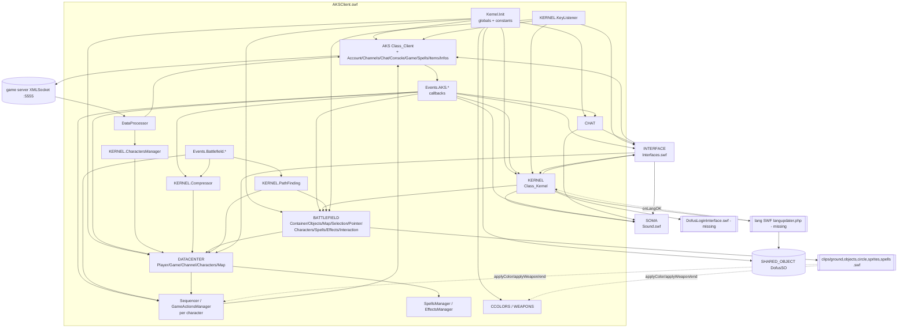

# Dofus beta 5b — client architecture & game logic

Scope: how `AKSClient.swf` (+ `modules/Interfaces.swf`, `modules/Sound.swf`) boots, which global singletons
exist, how they depend on each other, and the AS1 conventions a TypeScript port must reproduce.
Wire formats are documented message by message in `docs/protocol/` (other agent); here we only name the
handler that consumes a message.

All citations are `path:line` relative to `decompiled/clean/`. `UNKNOWN — not in code` = no evidence.
Statements marked **asset-side** come from SWF tag data (ExportAssets/ImportAssets names, frame labels, version
bytes) of files in `dofus-5b/`, not from code; data from `vendor/dofedex/` is always labelled **substitute**
(post-beta). `ui.md` uses the same asset-side class under the name "second evidence class" (child
instance names, frame labels and EditText text read with `tools/ffdec.sh -swf2xml`, cited as `swf sprite/char N`).

## Files in this directory

| File | Content |
|---|---|
| `README.md` | this file: boot, singletons, dependencies, AS1 runtime conventions, prototype extensions |
| `datacenter.md` | `DATACENTER` model classes and every field |
| `battlefield.md` | BattleField clip tree, depths, projection, cells, objects, selection/pointer/interaction, effects |
| `map-format.md` | `Compressor` map/cell decoding, cell fields, ground/object linkage, `backgroundNum` |
| `pathfinding.md` | A* variant, neighbourhood, costs, tackle zones, path compression, range and line of sight |
| `sequencer.md` | `Sequencer`, `GameActionsManager`, action queue/timeout, per-action client reaction |
| `fight.md` | turns, AP, spell casting flow, range/area, SpellsManager/EffectsManager, boosts |
| `characters.md` | sprite loading, animation labels/directions, recolouring, weapons, bubbles, smileys |
| `ui.md` | Interfaces.swf windows, lobby, banner, boxes, component library and the `INTERFACE` API |
| `sound.md` | Sound module (`SOMA`) |
| `input.md` | `KeyListener` shortcuts and chat console commands |
| `lang.md`, `lang-keys.json` | complete inventory of language keys and tables read from `SHARED_OBJECT.data` |
| `missing-content.md` | everything loaded from outside `dofus-5b/`, with the contract the code expects |

## 0. Runtime semantics the port must emulate (read first)

Every SWF in the archive has version byte **6** (`AKSClient.swf`, `Interfaces.swf`, `Sound.swf`, `ground.swf`,
`objects.swf`, sprites, spells — checked in the file headers). The following are **Flash Player 6 / SWF6 player
semantics, not verifiable from the code itself**; the code only works as intended under them:

1. **Identifiers and property names are case-insensitive.** In-code corroboration: `Compressor.init` stores
   lowercase base-64 letters under keys `"_a".."_z"` (`AKSClient/Dofus.Compressor.as:10-16`), which is only
   necessary if `obj["a"]` and `obj["A"]` are the same slot.
2. **`undefined` is `0` in numeric context** (`Number(undefined)`, `undefined + 1`, `undefined++`) and `""` in
   string concatenation. In-code corroboration: counters are incremented on fresh objects
   (`SpellsCountByTurn_Counter[id]++`, `AKSClient/Dofus.SpellsManager.as:27`).

Names that **look broken but resolve** under (1)/(2) — the port must treat them as the same thing:

| Written | Resolves to | Site |
|---|---|---|
| `spell.m_type` | `m_Type` | `AKSClient/Dofus.DataCenter.Player.as:103` |
| `cellData.PlayerOnID` | `playerOnID` | `AKSClient/Dofus.PathFinding.as:27`, `Events.Battlefield.Interaction.as:88,92,128`, `Dofus.BattleField.Map.as`, `Events.AKS.Game.as:778` |
| `DATACENTER.GAME` | `DATACENTER.Game` | `AKSClient/Dofus.BattleField.Characters.Character.as:50` |
| `BATTLEFIELD.MAP` | `BATTLEFIELD.Map` | `AKSClient/Events.AKS.Game.as:24` |
| `_loc1_.lowxp` | `lowXp` | `AKSClient/Dofus.Client.Game.as:401` |
| `DATACENTER.Game.IsRunning` | `isRunning` | `AKSClient/Dofus.DataCenter.Player.as:153`, `modules_Interfaces/DefineSprite_858_…/on(release).as:5` |
| `isNan(...)` | `isNaN` | `AKSClient/Dofus.DataCenter.Item.as:135` |
| `new Class_Datacenter_Game()` | `Class_DataCenter_Game` | `AKSClient/Dofus.Client.Game.as:138,168`, `Events.AKS.Channel.as:3` |
| `m_serverMessageID` | `m_ServerMessageID` | `AKSClient/Dofus.Client.as:41`, `Dofus.Client.DataProcessor.as:35` |
| `Round(cellnum…)` uses `cellNum` | same variable | `AKSClient/Dofus.BattleField.Interaction.as:166-170` |
| `getCellHeight` adds undefined `ph` | `+ 0` | `AKSClient/Dofus.BattleField.Map.as:307` |
| `Number(_loc1_.celdirl)` | `0` (not NaN) | `AKSClient/Dofus.CharactersManager.as:134` |

**Real defects** (do not resolve; a faithful port reproduces the *effect*, listed in the subsystem docs):

| Defect | Effect | Site |
|---|---|---|
| `celdirl` typo | character `dir` is `0` whenever the server sends a dir, else `null` | `AKSClient/Dofus.CharactersManager.as:134` |
| `SONA.onGameInvitation()` | no invitation sound | `AKSClient/Events.AKS.Game.as:268` |
| `chracData.num` | `removePlayerTimeline(undefined)` (harmless: `die()` removes it again) | `AKSClient/Events.AKS.Game.as:603`, `Dofus.BattleField.Characters.Character.as:704` |
| `this.endSmile()` (method is `endSmiley`) | smiley not removed on character clear | `AKSClient/Dofus.BattleField.Characters.Character.as:41,340` |
| `data.SEQUENCER_action.clear()` (missing `s`) | sequencers not cleared on sprite (re)build | `AKSClient/Dofus.BattleField.Characters.Character.as:32` |
| `octets[4]` in `uncompressMap` | `layerGroundFlip` always `false` from full map data | `AKSClient/Dofus.Compressor.as:61` |
| `bLayerGroundLevel/Slope/Flip` vs declared `bGroundLevel`, `bGroundSlope`, `bLayerGroundFilp` | single-cell updates never change groundLevel/groundSlope/groundFlip | `AKSClient/Dofus.Compressor.as:86-89,116,128,132` |
| Effect getters/setters added to `Class_DataCenter_Spell.prototype` | `Effect.type/value/remainingTurn` are plain (string) fields; `Spell` instances gain `type/value/remainingTurn` accessors | `AKSClient/Dofus.DataCenter.Effect.as:9-35` |
| `case 122` reads `tmpArray` before assigning it | message "BOOST_FRIEND_DAMAGES" never shown | `AKSClient/Events.AKS.Game.as:708-715` |
| `createCharacter(ID,name,Guild,Color1,…)` with 9 positional args | `GIP` player-info path builds a character with an undefined attribute object | `AKSClient/Dofus.Client.Game.as:337` vs `Dofus.CharactersManager.as:18` |
| `AKS.RandomGame` never constructed | every `R*` server message is dropped | `AKSClient/Dofus.Client.DataProcessor.as:409-440`, `Dofus.Client.as:9-34` |
| `ank.Extensions.addExtensions` never sets `bExtended = true` | re-installs on every call (harmless) | `AKSClient/__Packages/ank/Extensions.as:7-19` |
| `INTERFACE.InterfaceBanner` never assigned (only `UIInterfaceBanner`, `modules_Interfaces/Dofus.Interface.as:42`) | `AKS.Spells.onMovement` does not refresh the spell slot; self "hit" head anim never shown | `AKSClient/Events.AKS.Spells.as:3`, `Dofus.BattleField.Characters.Character.as:91` |
| `splice(i, i + 1)` while iterating | removes `i+1` elements and skips the next one | `AKSClient/Dofus.SpellsManager.as:60`, `Dofus.EffectsManager.as:75` |
| `BattleField.Effects.setVisible` uses `container.Effects` (clip is `Effect`) | no-op | `AKSClient/Dofus.BattleField.Effects.as:13` |

## 1. SWF loading and boot sequence

### 1.1 `AKSClient.swf` — one frame, all code in `DoInitAction` (`#initclip`) tags

Execution order = tag order in the SWF (verified in `decompiled/xml/AKSClient.xml`, sprite ids in brackets):

1. AS2 `__Packages` [126–134]: `dofus.graphics.battlefield.character.SmileyOverHead`, `dofus.Constants`,
   `ank.Timer`, `ank.SWFLoader`, `ank.Crypt`, `ank.PatternDecoder`, `ank.Extensions`,
   `ank.ext.MovieClipExtensions`, `ank.ext.StringExtensions` (class definitions only).
2. [5] `Dofus.Chat`, [6] `Math.getSlope`, [7] `String.getAddLeftChar`, [9] `MovieClip.onInitFrame`,
   [121…107] `Object.copyValues`, `MovieClip.*`, `TextField.*`, `Array.indexOf` (prototype extensions, §5).
3. [77] `DofusDataProviderSymbol` (`_global.DofusDataProviderClass`), [125] `SmileyOverHead`, [4] `ank::SWFLoader`
   linkage registrations.
4. [66, 67, 68] CharactersManager/Weapons/Colors, [96] Compressor, [89–83] `Dofus.Client.*` sub-clients,
   [64] SpellsManager, [82] DataProcessor, [81] `Client.Game`, [12] DialogBubble, [65] EffectsManager, [51] Sequencer, [95] PathFinding,
   [94] KeyListener, [93] `Dofus.Client`, **[92] `Dofus.Kernel`** (class only), [50] Cell, [49] GameActionsManager,
   [55, 61, 72, 73, 74, 70, 75, 52, 53, 54, 76, 56, 57, 58, 59, 60, 62, 71, 69, 63] BattleField and DataCenter
   classes, [80] `Dofus.DataCenter`.
5. **[91] `Dofus.Kernel.Init`** — creates the singletons (`AKSClient/Dofus.Kernel.Init.as:60-67`) and the
   `_global` helpers (`:68-155`). `new Class_Kernel()` immediately runs `Class_Kernel.prototype.init`
   (`AKSClient/Dofus.Kernel.as:5-27`), which **starts loading `modules/Interfaces.swf` and `modules/Sound.swf`**.
6. [104, 103, 102, 101, 100, 99, 98, 97, 105, 106] `Events.*` — attach the callback functions onto the
   *instances* `AKS`, `AKS.Account`, `AKS.Game`, … and `BATTLEFIELD.Interaction`, `BATTLEFIELD.Map`
   (e.g. `AKSClient/Events.AKS.as:1`). They must run after step 5 because they assign onto existing objects.
7. **[90] `Dofus.Kernel.Start`** last: debug credentials if `DEBUG_MODE`, then
   `ank.Extensions.addExtensions()` (`AKSClient/Dofus.Kernel.Start.as:1-6`), which installs the array-aware
   `String.prototype.replace` used by `getText` and `INTERFACE.draw` (§5). (AKSClient also exports a
   `String::replace` sprite [8] but it has no init action — only the DOFUS.swf shim defines an AS1 `replace`,
   `DOFUS/String.replace.as:1-13`.)

`Kernel.Init` step by step (`AKSClient/Dofus.Kernel.Init.as`):

```
_global.DOFUS = _root; Stage.scaleMode = "noScale"; _quality = "HIGH";          // :1-3
constants (VERSION=5, SERVER_PORT=5555, paths, URLs, colours, tables)           // :4-59
_global.AKS = new Class_Client();      // Dofus.Client.as:9-34 builds sub-clients + XMLSocket   :60
_global.DATACENTER = new Class_DataCenter();                                     // :61
_global.KERNEL = new Class_Kernel();   // loads Interfaces.swf + Sound.swf, see below           :62
_global.CHAT = new Class_Chat();                                                 // :63
this.attachMovie("Dofus::BattleField","bf",2);  // constructor sets _global.BATTLEFIELD        :64
_global.SHARED_OBJECT = SharedObject.getLocal("DofusSO");                       // :65
_global.CCOLORS = new Class_CharactersColors(); _global.WEAPONS = new Class_CharactersWeapons(); // :66-67
```

`this` inside a `DoInitAction` is presumably `_root` (UNKNOWN — not verifiable from code; nothing addresses the
clip by path `bf`, everything goes through `BATTLEFIELD`). Attaching `Dofus::BattleField` builds its nine child
layers and makes `BattleField.Container` start loading `clips/ground.swf` (once) and `clips/objects.swf` (twice:
`Object1` and `Object2`) at boot (`AKSClient/Dofus.BattleField.Container.as:13-44`).

`Class_Kernel.prototype.init` (`AKSClient/Dofus.Kernel.as:5-27`):

| Step | Effect |
|---|---|
| `DOFUS.createEmptyMovieClip("debug", 9999999)` | log sink (`_global.log` appends to `DOFUS.debug.log`, `Dofus.Kernel.Init.as:68-79`) |
| `PathFinding`, `Compressor`, `KeyListener`, `CharactersManager` | sub-objects of `KERNEL` (`KeyListener` registers itself with `Key` immediately, `Dofus.KeyListener.as:330`) |
| `DOFUS.createEmptyMovieClip("Interfaces",3).loadMovie("modules/Interfaces.swf")` | UI module |
| `DOFUS.Interfaces.onInitFrame = …` | when Interfaces.swf is fully loaded: create `DOFUS.lang` (depth 5000), `System.security.allowDomain(SITE_PATH)`, `DOFUS.lang.loadMovie(HTTP_LANG_PATH)`; when the lang SWF is loaded: `this.checkLanguage("fr", SHARED_OBJECT, INTERFACE, KERNEL)` |
| `DOFUS.createEmptyMovieClip("SoundManager",4).loadMovie("modules/Sound.swf")` | sound module, loads in parallel |

`onInitFrame` is the custom "fully loaded" hook from `AKSClient/MovieClip.onInitFrame.as` (§5).

### 1.2 `modules/Interfaces.swf`

Its own init actions run first (AS2 packages `dofus.Translator`, `dofus.Constants`, `ank.*`,
`dofus.graphics.gui.*`, then ~110 AS1 interface classes), then its root `frame_1`:

```
this.attachMovie("Dofus::Interface","interfaceClip",0);   // modules_Interfaces/frame_1/DoAction.as:1
_global.INTERFACE = this.interfaceClip;                   // :2
```

`Class_Interface.init` creates `CommonLayer_mc` (10), `BoxLayer_mc` (20), `MainLayer_mc` (30) and attaches
`waiting`, `Text`, `BugReport`, `Mask` (`modules_Interfaces/Dofus.Interface.as:9-36`). Full UI documentation:
`ui.md`.

### 1.3 Language

`langupdater.php` (`HTTP_LANG_PATH`, `AKSClient/Dofus.Kernel.Init.as:28`) must return a SWF exposing
`checkLanguage(lang, so, iface, kernel)` on its root. Contract inferred from the call sites only:
fill `SHARED_OBJECT.data` with keys and tables (`lang.md`) and eventually call `KERNEL.onLangOK()`
(defined `AKSClient/Dofus.Kernel.as:28-55`; its first action is `INTERFACE.hideProgressBar()`, so the lang SWF
presumably drives `INTERFACE.showProgressBar/updateProgressBar`). Whether it caches/compares versions is
UNKNOWN — not in code. Missing file: see `missing-content.md`.

### 1.4 Login

`KERNEL.onLangOK` POSTs a `LoadVars` to `http://SITE_PATH/files/login/getuser.php` (`AKSClient/Dofus.Kernel.as:31-54`):

* response has `l` → `DATACENTER.Player.login = l`, `.password = p`, `AKS.connect(SERVER_NAME, SERVER_PORT)`
  (auto-login from the web session);
* otherwise (or on failure) → `INTERFACE.drawLoginInterface()`, which loads
  `HTTP_LOGIN_PATH + "swf/DofusLoginInterface.swf"` into `CommonLayer_mc.loginInterface` and gives it an
  `onLogin(login, password)` callback that stores the credentials and calls `AKS.connect`
  (`modules_Interfaces/Dofus.Interface.as:63-81`). Enter in fields named `txtName`/`txtPass` also logs in
  (`AKSClient/Dofus.KeyListener.as:93-98`).

### 1.5 From socket to first screen

```
AKS.connect → XMLSocket.connect(SERVER_NAME, 5555)                    Dofus.Client.as:44-51
server "H<key>" → m_UID = key, AKS.onConnect(true)                   Dofus.Client.DataProcessor.as:29-33
AKS.onConnect → AKS.logon(login, password)                           Events.AKS.as:1-16
  send VERSION+"\n", login+"\n"+ank.Crypt.cryptPassword(pw, key)+"\n" Dofus.Client.as:57-74
"AlK<lang>" → AKS.onLogin(true,…,lang)                               Dofus.Client.DataProcessor.as:73-78
AKS.onLogin → INTERFACE.drawMenuInterface() (UIStartMenu)            Events.AKS.as:43-69
  (or AKS.Account.getCharacters() directly if m_bSkipMenu, set by KERNEL.quit)
menu "play" → AKS.Account.getCharacters() → "AL…" → Interface::Characters  Events.AKS.Account.as:1-6
character chosen → "AS…" (31 fields) → createCharacter + AKS.Game.createSolo()  Dofus.Client.DataProcessor.as:153-203, Events.AKS.Account.as:7-18
"GC" solo → onCreateSolo → Banner UI, next frame GetMapData → "GDM…" → uncompressMap → Map.build  Events.AKS.Game.as:1-20
```

The solo game is the "village" (`SOMA.onEnterVillage`, `AKSClient/Events.AKS.Game.as:12`); multiplayer lobby is
reached via game action type 3 / `KERNEL.changeToMultiplayer` (`AKSClient/Dofus.Kernel.as:103-112`).

## 2. `_global` singletons and globals

| Global | Defined | Class / value | Responsibilities |
|---|---|---|---|
| `DOFUS` | `AKSClient/Dofus.Kernel.Init.as:1` | `_root` | parent of `debug`, `Interfaces`, `SoundManager`, `lang`, `clipOver`; `DOFUS.onEnterFrame` used as a one-frame defer (`Events.AKS.Game.as:7-11`) |
| `AKS` | `Dofus.Kernel.Init.as:60` | `Class_Client` (`Dofus.Client.as`) | socket, send (truncate to `MAX_DATA_LENGTH`, open "waiting" UI, `Dofus.Client.as:75-89`), sub-clients `Account`, `Channels`, `Chat`, `Console`, `Game`, `Spells`, `Items`, `Infos`, `DataProcessor`; event callbacks in `Events.AKS*.as`; `output` back-references set by UI clips (`AKS.Chat.output`, `AKS.Game.output`, `AKS.Infos.output`, `AKS.Account.output`, `AKS.Spells.output`; e.g. `modules_Interfaces/Interface.Banner.as:20-21`) |
| `DATACENTER` | `Dofus.Kernel.Init.as:61` (also `Dofus.DataCenter.as:3`) | `Class_DataCenter` | game state model (`datacenter.md`); `clear()` on disconnect keeps login/password |
| `KERNEL` | `Dofus.Kernel.Init.as:62` | `Class_Kernel` (`Dofus.Kernel.as`) | boot/lang/login, map draw, player interface, spell/CC targeting mode, turn cleanup, quit/disconnect/give-up dialogs; owns `PathFinding`, `Compressor`, `KeyListener`, `CharactersManager` |
| `CHAT` | `Dofus.Kernel.Init.as:63` | `Class_Chat` (`Dofus.Chat.as`) | chat log by type (colour → type), renders last 30 lines into `AKS.Chat.output.txtChat`, triggers whisper/error sounds |
| `BATTLEFIELD` | `Dofus.BattleField.as:3` (instance attached by `Dofus.Kernel.Init.as:64`) | `Class_BattleField` (MovieClip) | map rendering and interaction (`battlefield.md`) |
| `SHARED_OBJECT` | `Dofus.Kernel.Init.as:65` | `SharedObject "DofusSO"` | language data (`lang.md`); **also** sound settings `muteSound`, `muteMusic`, `volumeMusic`, `volumeSound` (same cookie name, `modules_Sound/Dofus.Sound.Manager.as:3,15-16`) |
| `CCOLORS` | `Dofus.Kernel.Init.as:66` | `Class_CharactersColors` | per-character colour table, `applyColor(clip, zone)` called from sprite SWFs (`characters.md`) |
| `WEAPONS` | `Dofus.Kernel.Init.as:67` | `Class_CharactersWeapons` | per-character weapon, `applyWeapon(clip, side)` called from sprite SWFs |
| `log`, `getText`, `getSpellText`, `getCCText`, `getMapText`, `getGuildText`, `getItemTypeText`, `getItemSuperTypeText`, `getItemEffectText` | `Dofus.Kernel.Init.as:68-155` | functions | debug log, language lookup (`lang.md`) |
| constants | `Dofus.Kernel.Init.as:4-59` | see §2.1 | |
| `DofusDataProviderClass` | `AKSClient/DofusDataProviderSymbol.as:1` | list model with views | `datacenter.md` §1 |
| `INTERFACE` | `modules_Interfaces/frame_1/DoAction.as:2` | `Class_Interface` (`modules_Interfaces/Dofus.Interface.as`) | all UI (`ui.md`) |
| `SOMA` | `modules_Sound/Dofus.Sound.Manager.as:206` | `Class_Sound_Manager` (MovieClip) | sound/music (`sound.md`) |
| `BOUCLE_INFINIE`, `MUSIC_FIGHT` | `modules_Sound/Dofus.Sound.Event.as:1-2` | 9999, fight music list | |
| `FStyleFormat`, `FLabelClass`, `DataProviderClass`, `_popUpLevel` | `modules_Interfaces/FUIComponentSymbol.as:265`, `FLabelSymbol.as:1`, `DataProviderSymbol.as:1`, `Ank.Dofus.ComboBox.as:4` | Macromedia UI component support | `ui.md` |
| `SEXE` | `modules_Interfaces/DefineButton2_696/…on(release).as:2`, `DefineButton2_697/…:2` | 0/1 | character-creation sex choice |
| `isLogged` | `AKSClient/Events.AKS.as:41,57` | boolean (implicit timeline variable) | whether a disconnect shows the "DISCONNECT" box |

**Referenced but defined outside the decompiled code** (port must supply or replace):

| Reference | Expected from | Site |
|---|---|---|
| `checkLanguage(lang, so, iface, kernel)` | lang SWF from `langupdater.php` (missing) | `AKSClient/Dofus.Kernel.as:21` |
| login SWF calling `onLogin(login, password)`; fields `txtName`, `txtPass` | `files/login/swf/DofusLoginInterface.swf` (missing) | `modules_Interfaces/Dofus.Interface.as:70-79`, `AKSClient/Dofus.KeyListener.as:93-98` |
| `getuser.php` → `l`, `p`; `delpath.php` (POST `path`) | web server (missing) | `AKSClient/Dofus.Kernel.as:31-54`, `Events.AKS.as:78-92` |
| `Ground.attach(num, name, depth)` → holder with `.clip`, `Ground.clear()`, `Object1.attach`, `ObjectN.clips`, `ObjectN.clear()` | root script of `clips/ground.swf` / `clips/objects.swf` (`clips/ground.swf/frame_1/DoAction.as:1-12`; `map-format.md` §5.1) | `AKSClient/Dofus.BattleField.Map.as:51,78,103`, `Dofus.BattleField.Container.as:20,29,43`, `Dofus.BattleField.Objects.Object.as:12` |
| `circle.animate(bool)`, `circle.setColor(rgb)` | `clips/circle.swf/frame_1/DoAction.as:1-16` | `AKSClient/Dofus.BattleField.Characters.Character.as:182-193` |
| calls to `CCOLORS.applyColor`, `WEAPONS.applyWeapon`, `MovieClip.end()`, `getActionClip().wait()`, `SOMA.playSound`; `level/angle/cellFrom/cellTo/rotate` consumers | scripts in `decompiled/clean/clips/sprites/*.swf/` and `clips/spells/*.swf/` | `characters.md` §2.1/§5, `sequencer.md` §1.1, `sound.md` §5.1, `fight.md` §6 |
| `AKS.RandomGame` | nothing — never constructed | `AKSClient/Dofus.Client.DataProcessor.as:415-439` |
| `SONA` | nothing (typo of `SOMA`) | `AKSClient/Events.AKS.Game.as:268` |
| `INTERFACE.InterfaceBanner` | nothing (`UIInterfaceBanner` exists) | `AKSClient/Events.AKS.Spells.as:3` |

### 2.1 Constants (`AKSClient/Dofus.Kernel.Init.as`)

| Name | Value | Used by |
|---|---|---|
| `DEBUG_MODE` | `false` (:4) | `Dofus.Kernel.Start.as:1`, `Dofus.KeyListener.as:155,233`; when true: `SERVER_NAME="kam"`, `SITE_PATH="jouer.dofus.lan"` (:17-23) |
| `VERSION` | `5` (:5) | sent at logon (`Dofus.Client.as:72`), `/version` (`Dofus.Client.Console.as:33`), `BAD_VERSION` text. (`dofus.Constants.VERSION = 4`, `DEBUG = true`, `SERVER_NAME = "dofus"` are stale and unused, `AKSClient/__Packages/dofus/Constants.as:3-6`) |
| `SERVER_NAME`, `SERVER_PORT` | `"server01.dofus.com"`, `5555` (:26, :6) | `Dofus.Kernel.as:42,300`, `Dofus.KeyListener.as:97`, `modules_Interfaces/Dofus.Interface.as:76` |
| `PATH`, `MODULE_PATH`, `CLIPS_PATH`, `CLIPS_PERSOS_PATH`, `SPELLS_PATH` | `""`, `"modules/"`, `"clips/"`, `"clips/sprites/"`, `"clips/spells/"` (:7-11) | module/asset loading |
| `GUILDS_PATH`, `GUILDS_MINI_PATH`, `GUILDS_FACES_PATH`, `GUILDS_BIG_PATH`, `GUILDS_DESCRIPTIONS_PATH` | `clips/guilds/…` (:12-16) | Interfaces (`ui.md`) |
| `SITE_PATH` | `"jouer.dofus.com"` (:27) | all HTTP URLs |
| `HTTP_LANG_PATH`, `HTTP_LOGIN_PATH`, `HTTP_MAPS_PATH`, `HTTP_NEWS_FILE`, `HTTP_BUG_REPORT` | `…/files/lang/langupdater.php`, `…/files/login/`, `…/files/maps/`, `…/files/news/news.php`, `…/files/bugreport/index.php` (:28-33) | `missing-content.md` |
| `MUSIC_PATH` | `"music/"` (:34) | `modules_Sound/Dofus.Sound.Manager.as:159` |
| `LOGIN_INTERFACE_FILE` | `"DofusLoginInterface"` (:35) | `modules_Interfaces/Dofus.Interface.as:79` |
| `MENU_INTERFACE_FILE` | `"DofusMenu"` (:36) | unused |
| `CLICK_MINIMUM_TIMER` | `500` ms (:37) | move-click debounce, `Events.Battlefield.Interaction.as:12` |
| `NEWS_DELAY` | `10000` (:38) | `modules_Interfaces/Interface.NewsScroller.as:65` |
| `DEFAULT_GUILD` | `1` (:39) | `modules_Interfaces/DoInitAction.as:7` |
| `SEQUENCER_TIMEOUT` | `10000` ms (:40) | `Dofus.Sequencer.as:41`, `Dofus.BattleField.Spells.as:28` |
| `MAX_DATA_LENGTH` | `200` (:41) | `Dofus.Client.as:78-80` |
| `INFO_CHAT_COLOR`, `MSG_CHAT_COLOR`, `MSGCHUCHOTE_CHAT_COLOR`, `ERROR_CHAT_COLOR` | `"66FF00"`, `"C6ECFF"`, `"FFFFFF"`, `"FF9900"` (:42-45) | chat type is derived from the colour (`Dofus.Chat.as:52-71`) |
| `CELL_OVER_COLOR` | `0x444444` (:46) | unused |
| `CELL_PATH_COLOR`, `CELL_PATH_OVER_COLOR` | `0xFF6600` (:47-48) | path preview |
| `CELL_PATH_USED_COLOR`, `CELL_PATH_SELECT_COLOR`, `CELL_SPELL_RANGE_COLOR` | `0x246696` (:49-50, :52) | path walked / clicked / spell range |
| `CELL_SPELL_EFFECT_COLOR` | `0xFF6600` (:51) | spell area |
| `LIFE_POINT_COLOR`, `ACTION_POINT_COLOR` | `0xFF0000`, `0x0000FF` (:53-54) | floating numbers |
| `TEAMS_COLOR` | `[0xFF0000, 0x0000FF]` (:55) | team circles, placement cells |
| `GUILD_NAMES` | `[null,"Féca","Osamodas","Enutrof","Sram","Xélor","Ecaflip","Eniripsa","Iop","Crâ","Sadida"]` (:56) | `Character.guildName` |
| `PLAYER_HEIGHT` | `[0,1.5×10]` (:57) | line of sight (`pathfinding.md`) |
| `SPELL_BOOST_BONUS` | `[0,5,8,13,20]` (:58) | spell-boost **cost in bonus points** indexed by current level (`fight.md`) |
| `SPELL_BOOST_COST` | `[100,200,300,400]` (:59) | unused |

## 3. Module dependency diagram



## 4. AS1 class pattern and linkage

Every class follows the same shape (example `AKSClient/Dofus.BattleField.Map.as:1-8`):

```
Class_BattleField_Map = function() { this.init(); };          // constructor
Class_BattleField_Map.prototype = new MovieClip();             // "extends MovieClip" (or new Object())
Object.registerClass("Dofus::BattleField::Map", Class_BattleField_Map);  // link library symbol → class
Class_BattleField_Map.prototype.foo = function(){…};
ASSetPropFlags(Class_BattleField_Map.prototype, null, 1, 1);   // hide all prototype members from for..in
```

* `Object.registerClass(linkageName, ctor)`: when a library symbol exported under `linkageName` is instantiated
  (`attachMovie(linkageName, …)` or placed on stage), the player sets its `__proto__` to `ctor.prototype` and runs
  `ctor` with `this` = the clip. That is how `BATTLEFIELD.attachMovie("Dofus::BattleField::Container", …)` builds
  objects (`AKSClient/Dofus.BattleField.as:11-19`). Linkage names use `::` (`Dofus::BattleField::Map`) while the
  decompiled file names use `.`.
* Non-visual classes are registered too but only ever created with `new` (e.g. `Dofus::Client`,
  `Dofus::DataCenter::Player`); `Class_DataCenter` and `Class_BattleField_Effects/Spells` have a
  `new MovieClip()`/`new Object()` prototype but are plain objects.
* AS2 classes in `__Packages` are linked with `Object.registerClass("SmileyOverHead", eval("dofus.graphics…"))`
  (`AKSClient/SmileyOverHead.as:1`, `AKSClient/ank.SWFLoader.as:1`).
* Getter/setter properties via `addProperty(name, getter, setter)` (e.g. `Character.LP`,
  `AKSClient/Dofus.DataCenter.Character.as:51-61`) — setters broadcast change events via `ASBroadcaster`.
* `ASSetPropFlags(proto, null, 1, 1)` makes prototype members non-enumerable — required because the code
  iterates objects with `for…in` (e.g. `DofusDataProviderClass.keys`, MovieClip children).
* Clips referenced by instance name (`this.sprite.clip`, `INTERFACE.MainLayer_mc.waiting`) — the port needs a
  display tree with named children and depth ordering (`swapDepths`, `getDepth`).
* Callback style: `obj.onX = function(){}` assigned from outside (Events.* files) instead of listeners;
  `ASBroadcaster` used only for `DATACENTER.Player`/`Character` change events.

## 5. Prototype extensions (must be replicated)

| Extension | Defined | Behaviour |
|---|---|---|
| `String.prototype.replace(from, to)` | `AKSClient/__Packages/ank/ext/StringExtensions.as:7-48`, installed by `ank.Extensions.addExtensions()` (`__Packages/ank/Extensions.as:7-19`) at `Kernel.Start` and by `PatternDecoder` | split/join replace-all; `from` may be an Array, `to` an Array (pairwise) or a single value; 1 arg = delete. Used by `getText` (`"%1".."%n"` → params, `Dofus.Kernel.Init.as:96`), `INTERFACE.draw` (`":"` removal), chat sanitising (`Dofus.Client.Chat.as:17`, `Dofus.Client.Channels.as:22`) |
| `MovieClip.prototype.attachClassMovie(ctor, name, depth)` | `__Packages/ank/ext/MovieClipExtensions.as:7-13`, installed with the above | empty clip whose `__proto__` = `ctor.prototype`, then `ctor.apply(clip)` |
| `MovieClip.prototype.onInitFrame` (setter property) | `AKSClient/MovieClip.onInitFrame.as:1-35` | assigning a function registers a watcher clip under `_level0._onInitFrameClips_` (depth 10000000) that polls every frame until `getBytesLoaded() == getBytesTotal() && total > 4`, then copies `data`, calls the function with `this` = the loading clip, and removes itself. Used as "on SWF loaded" for every `loadMovie` |
| `MovieClip.prototype.end(sequencer)` | `AKSClient/MovieClip.end.as:1-12` | called from inside animation/spell SWFs: finds the action owner (`getActionClip`) and the object (`getObjectClip`), defaults `sequencer` to `owner.data.SEQUENCER_anim`, then `sequencer.onActionEnd(object[sequencer.unicID])` (`sequencer.md`) |
| `getActionClip()` / `getObjectClip()` / `getRootAnimClip()` | `AKSClient/MovieClip.getActionClip.as`, `.getObjectClip.as`, `.getRootAnimClip.as` | walk up ≤ 21 parents to the first clip with `_ACTION`, return `_ACTION` / `_OBJECT` / (`_ROOTANIM`) |
| `playFirstChildren()` | `AKSClient/MovieClip.playFirstChildren.as` | `gotoAndPlay(1)` on direct MovieClip children (restart an animation after a label jump) |
| `playAllClip()` / `stopAllClip()` | `AKSClient/MovieClip.playAllClip.as`, `.stopAllClip.as` | recursive play/stop |
| `getAllCurrentFrames()` / `setAllCurrentFrames(obj, stop)` | `AKSClient/MovieClip.getAllCurrentFrames.as`, `.setAllCurrentFrames.as` | snapshot/restore frame numbers of a clip tree (no caller in AKSClient) |
| `drawArc(x, y, r, arc, start, yr)` | `AKSClient/MovieClip.drawArc.as` | curveTo arc in ≤ 45° segments (no caller in AKSClient) |
| `TextField.prototype.setText(text, font="Font2", color?, size?)` | `AKSClient/TextField.setText.as` | set text + embedded font format |
| `TextField.prototype.setHtmlText(html, font="Font2")` | `AKSClient/TextField.setHtmlText.as` | html text + embedded font |
| `TextField.prototype.initChat()` | `AKSClient/TextField.initChat.as` | fill with newlines until the field scrolls (so new chat lines appear at the bottom) |
| `Array.prototype.indexOf(v)` | `AKSClient/Array.indexOf.as` | searches from the end; returns `null` (not -1) when absent |
| `String.prototype.getAddLeftChar(ch, size)` | `AKSClient/String.getAddLeftChar.as` | left-pad (`"7".getAddLeftChar("0",3) == "007"`, used for game action ids, `Dofus.Client.Game.as:100`) |
| `Object.prototype.copyValues(src)` | `AKSClient/Object.copyValues.as` | shallow copy of enumerable props |
| `Math.getSlope(x1,y1,x2,y2)` | `AKSClient/Math.getSlope.as` | `(y1-y2)/(x1-x2)` (line of sight) |
| fonts `Font1`, `Font2`, `Font3` | exported by AKSClient.swf (ids 3, 2, 1) | used by name everywhere in `setText` |
| `clipOver` | AKSClient export 124 (button 123: `on(rollOver, rollOut) removeMovieClip()`, `AKSClient/DefineButton2_123/…as`) | `KERNEL.forceOver()` drops it under the mouse to force a fresh rollOver on whatever is below (`AKSClient/Dofus.Kernel.as:266-269`) |

AS2 helpers: `ank.Timer.setTimer(obj, fn, ms, args)` = one-shot timer bound to `obj` (`__Packages/ank/Timer.as`);
`ank.SWFLoader` = clip that loads a SWF into `swf_mc`, `gotoAndStop(frame)` and broadcasts `onLoadComplete`
(`__Packages/ank/SWFLoader.as`); `ank.PatternDecoder` = description/gender templating (`lang.md` §4);
`ank.Crypt.cryptPassword` (`__Packages/ank/Crypt.as`, see `docs/protocol/`).
