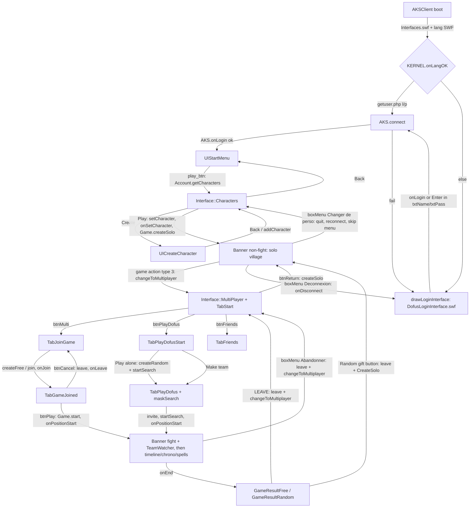

# UI module — `modules/Interfaces.swf` (beta 5b)

Scope: everything under `decompiled/clean/modules_Interfaces/`, plus the AKSClient call sites that drive it.
Wire formats are documented in `docs/protocol/`; here only `AKS..<method>()` names and callbacks.

## 0. Conventions

- Citations are relative to `decompiled/clean/`. Abbreviations (1:1 with real paths):
  - `MI/` = `modules_Interfaces/`, `AK/` = `AKSClient/`, `SO/` = `modules_Sound/`.
  - `S<n>` = `MI/DefineSprite_<n>[_<linkage>]/frame_1/` (other frames: `S<n>@f<k>`). `S<n>/DoAction:<l>` = its `DoAction.as`.
  - `S<n>/<po> init|load|rel` = `…/PlaceObject2_<po>/CLIPACTIONRECORD on(initialize)|onClipEvent(load)|on(release).as`.
    `PB_<d>` = `27_Ank.Dofus.PushButton_<d>`, `CB_<d>` = `244_Ank.Dofus.ComboBox_<d>`, `LB_<d>` = `240_Ank.Dofus.ListBox_<d>`,
    `CK_<d>` = `249_Interface.CheckBox_<d>`; anything else is the literal suffix (e.g. `285_47`). `<d>` is the placement depth.
  - `B<n> rel|over|out|press` = `MI/DefineButton2_<n>[_<name>]/BUTTONCONDACTION on(release)|on(rollOver)|on(rollOut…)|on(press).as`.
- **Second evidence class (not in `decompiled/clean`)**: child instance names, frame labels and static EditText text were read from
  `tools/ffdec.sh -swf2xml dofus-5b/modules/Interfaces.swf` streamed to stdout (nothing persisted). Cited as `swf sprite N` / `swf char N`.
  Used only where the `.as` files do not name a child, mainly to prove absences, plus Appendix B.
- SWF6 semantics assumed throughout: identifiers and object keys are case-insensitive (`setlabel`==`setLabel`, `Range`==`RANGE`,
  `DATACENTER.GAME`==`DATACENTER.Game`), `undefined` concatenates as `""`, calling an undefined function is a silent no-op.
  Only names that do not resolve case-insensitively are reported as bugs.

---

## 1. Module overview

### 1.1 Boot

1. `AK/Dofus.Kernel.as:13-14` creates `DOFUS.Interfaces` (depth 3 of `_root`) and `loadMovie(MODULE_PATH + "Interfaces.swf")` (`MODULE_PATH = "modules/"`, `AK/Dofus.Kernel.Init.as:8`).
2. All Interfaces classes are `#initclip` blocks: each top-level `MI/*.as` is one block that defines a constructor and calls
   `Object.registerClass(<linkage>, <ctor>)`. AS2 classes live in `MI/__Packages/` and are bound to linkages by one-line blocks such as
   `Object.registerClass("UIStartMenu", eval("dofus.graphics.gui.UIStartMenu"))` (`MI/UIStartMenu.as:1`). The AS2 classes shared with
   AKSClient (`dofus.Constants`, `ank.SWFLoader`, `ank.PatternDecoder`, `ank.Extensions`, `ank.ext.*`) are byte-identical in both
   SWFs (diffed), so it does not matter which definition wins.
3. Root timeline `MI/frame_1/DoAction.as:1-2`: `this.attachMovie("Dofus::Interface","interfaceClip",0); _global.INTERFACE = this.interfaceClip;`
   → `INTERFACE` is the `Class_Interface` clip (`MI/Dofus.Interface.as:1-6`), constructor calls `init()`.
4. `MI/DoInitAction.as` is **dead code**: registers `Class_CreateCharacter` to linkage `"Interface::CreateCharacter"` (`:13`), but no
   symbol is exported under that name (swf export list). See §2.6.
5. When Interfaces.swf finishes loading, `DOFUS.Interfaces.onInitFrame` (`AK/Dofus.Kernel.as:15-24`) loads the lang SWF
   (`HTTP_LANG_PATH`) into `DOFUS.lang` and calls `this.checkLanguage("fr", SHARED_OBJECT, INTERFACE, KERNEL)` on it — the missing lang
   SWF receives `INTERFACE` (presumably for `showProgressBar/updateProgressBar`, which nothing in `decompiled/clean` calls — UNKNOWN) and
   `KERNEL`; `KERNEL.onLangOK()` (`AK/Dofus.Kernel.as:28-55`) has no caller in `decompiled/clean`, so presumably the lang SWF calls it. It hides the progress bar and either auto-logs in from
   `http://<SITE_PATH>/files/login/getuser.php` (vars `l`,`p`) or calls `INTERFACE.drawLoginInterface()`.
   - `onInitFrame` is an AKSClient `MovieClip` property setter (`AK/MovieClip.onInitFrame.as:1-35`): it polls every frame until
     `getBytesLoaded()==getBytesTotal() && total>4`, then calls the function with `this` = the (re)loaded clip. Every
     `loadMovie` in the UI that needs a callback uses it.
6. `String.prototype.replace` (used by `INTERFACE.draw`) is the AS2 `ank.ext.StringExtensions.replace` (split/join, array forms),
   installed by `ank.Extensions.addExtensions()` from `AK/Dofus.Kernel.Start.as:6` (`MI/__Packages/ank/Extensions.as:7-19`,
   `MI/__Packages/ank/ext/StringExtensions.as:7-48`). So `"Interface::Banner".replace(":","")` = `"InterfaceBanner"`.
7. `TextField.prototype.setText(text, font="Font2", color, size)`, `setHtmlText(text, font)`, `initChat()` used everywhere by the UI are
   AKSClient extensions (`AK/TextField.setText.as:1-17`, `AK/TextField.setHtmlText.as:1-10`, `AK/TextField.initChat.as:1-9`): they set
   the text then `setTextFormat` with the embedded font and `embedFonts=true`. Fonts `Font1`/`Font2`/`Font3` are exported (swf chars 3/2/1).

### 1.2 Globals defined by Interfaces.swf

| Global | Site | Note |
|---|---|---|
| `_global.INTERFACE` | `MI/frame_1/DoAction.as:2` | the only one AKSClient uses |
| `_global.DataProviderClass` | `MI/DataProviderSymbol.as:1` | list model (AKSClient has its own `DofusDataProviderClass`) |
| `_global.FLabelClass` | `MI/FLabelSymbol.as:1` | |
| `_global.FStyleFormat` | `MI/FUIComponentSymbol.as:265` | Macromedia style object |
| `_global.globalStyleFormat`, `_global._focusControl` | `MI/FUIComponentSymbol.as:16-27` | created by first component init |
| `_global._popUpLevel` | `MI/Ank.Dofus.ComboBox.as:4` | starts 20000, +1 per ComboBox; popups go into `_root.superHolder<N>` |
| `_global.SEXE` | `B696 rel:2`, `B697 rel:2` | dead tree only (§2.6) |
| `_global.dofus.*`, `_global.ank.*` | `MI/__Packages/` | AS2 namespaces |

All `Class_*` constructors (e.g. `Class_Interface`) are plain timeline variables of the Interfaces root, not globals.

### 1.3 Layers / depths (all inside `INTERFACE`)

| Clip | Depth | Created | Contents |
|---|---|---|---|
| `CommonLayer_mc` | 10 | `MI/Dofus.Interface.as:12` | screens: login (1), menu (1), `draw()` symbols at caller depth (Characters 1, MultiPlayer 1, UICreateCharacter 1, Banner 200, AnimSelectionSymbol 4000) |
| `BoxLayer_mc` | 20 | `:13` | `WindowBox` boxes all at depth **10** (`:110,115,120,125,130`), `nextTurnBoxClip` at 20 (`:138`) |
| `MainLayer_mc` | 30 | `:14` | `waiting` 10 (`_x:742`, `:16`), `Text` 20 (`:17`), `BugReport` 30 (`:19`), `Mask` (`GlobalMask`) 40 (`:20`), `progressBar` 60 (`:146`), `cursor` 70 (`:164`), `spellcursor` 80 (`:182`), `tooltip` 9000 (`:209`) |
| `teamWatcher` | 4700 | `:233` | attached on `INTERFACE` itself at (371,430) — **not** cleared by `clear()` |
| `fps` | 999999999 | `:242` | `fpsDetectorSymbol` |

Porter-relevant consequences:
- **One modal box at a time.** All five boxes attach at `BoxLayer_mc` depth 10; attaching replaces the previous clip. A `msgBox`
  arriving while a `questionBox` is open silently destroys it, and `INTERFACE.onQuestionBoxYes/No` stay assigned.
- **One screen at depth 1.** Login, menu, Characters, MultiPlayer and UICreateCharacter share `CommonLayer_mc` depth 1;
  e.g. Characters' Back button calls `drawMenuInterface()` without `clear()` (`S644/PB_65 rel:2`) and simply replaces it.
- `MainLayer_mc.Mask` (`GlobalMask`, swf sprite 913) has no code; purpose UNKNOWN — not in code.

### 1.4 `INTERFACE` public API (`MI/Dofus.Interface.as`)

Fields: `layers` (`:15`, map name→clip for `draw/hide/clear`), `Text` (`:18`, alias of `MainLayer_mc.Text`), `listBox_sf` (`:21-27`,
FStyleFormat Font3 8 pt white, disabled `0x589ED3`; every ListBox does `INTERFACE.listBox_sf.addListener(this); applyChanges()` in its
load handler), `comboBox_sf` (`:28-34`, never used), `lastSpellcursorData` (`:35`), `spellcursor`, `UILoginInterface` (`:69`),
`UI<name>` (set by `draw`, `:42`), `teamWatcher`, `fps`, `onQuestionBoxYes/No` (prototype `undefined`, `:7-8`; assigned by callers).

| Member | Def | Behaviour | Called from (AKSClient unless MI/) |
|---|---|---|---|
| `draw(symbol, depth)` | `:37-44` | `name = symbol.replace(":","")`; `layers[name] = CommonLayer_mc.attachMovie(symbol, name, depth)`; `INTERFACE["UI"+name] = clip`; returns clip | `Dofus.Kernel.as:81` (Banner), `:110` (MultiPlayer); `Events.AKS.Account.as:3` (Characters); `Dofus.CharactersManager.as:164` (UICreateCharacter); `MI/Dofus.Interface.as:97` |
| `hide(symbol)` | `:45-50` | remove `layers[name]` | `:105` only |
| `clear()` | `:51-62` | remove every `layers` entry, `hideToolTip()`, `setCursor(null)`, `setSpellCursor(null)`. Does not touch BoxLayer, `teamWatcher`, `Text`, `progressBar` | `Dofus.Kernel.as:109`; `Events.AKS.Game.as:4,315`; `Events.AKS.as:33,47`; `Events.AKS.Account.as:11`; `Dofus.CharactersManager.as:163` |
| `drawLoginInterface()` | `:63-81` | see §2.1 — loads external `DofusLoginInterface.swf` | `Dofus.Kernel.as:46,51`; `Events.AKS.as:11,38,64` |
| `drawMenuInterface()` | `:82-94` | attach `UIStartMenu` as `MenuInterface` at depth 1; `setInfos([SITE_PATH])` (**no such method** in `MI/__Packages/dofus/graphics/gui/UIStartMenu.as` → no-op); sets `onPlay = AKS.Account.getCharacters()` (never invoked: UIStartMenu wires `play_btn` itself) | `Events.AKS.as:55`; `S644/PB_65 rel:2` |
| `drawAnimSelection(x,y)` / `hideAnimSelection()` | `:95-106` | `draw("AnimSelectionSymbol",4000)`, position, scale = `BATTLEFIELD.Container._xscale` (both axes) | `Events.Battlefield.Interaction.as:23`; `Events.AKS.Game.as:519` |
| `msgBox(msg)` | `:107-111` | `Text.clearText()`; WindowBox `boxMessage`, title `getText("INFORMATIONS")` | `Events.AKS.as:14,30,67,74`; `Events.AKS.Items.as:3,7,18`; `Events.AKS.Game.as:555,560,563`; `Dofus.Client.Items.as:57,69,75`; `Events.AKS.Account.as:188`; many MI/ sites |
| `questionBox(msg)` | `:112-116` | WindowBox `boxYesNo`, title `QUESTION`; Yes → `INTERFACE.onQuestionBoxYes()`, No → `onQuestionBoxNo()` then close (`S897/PB_8 rel:2-3`, `S897/PB_2 rel:2-3`) | `Dofus.Kernel.as:302,310,327`; `Events.AKS.Game.as:267`; `MI/__Packages/dofus/graphics/gui/common/InventoryViewer.as:166` |
| `onQuestionBoxYes/No` | assigned | callbacks are never reset after use except `Events.AKS.Game.as:272-273` | `Dofus.Kernel.as:296,306,322`; `Events.AKS.Game.as:259,263` |
| `hideQuestionBox()` | `:132-135` | remove `BoxLayer_mc.boxYesNo` | `Events.AKS.Game.as:274` |
| `wisperBox(to)` | `:117-121` | WindowBox `boxWhisper`, title `WISPER_MESSAGE + " " + TO + " " + to`, params `{msg: <undeclared, undefined>, to}` | MI/ list double-clicks only |
| `optionsBox()` / `menuBox()` | `:122-131` | WindowBox `boxOptions` (title `OPTIONS`) / `boxMenu` (title `MENU`) | `Dofus.Kernel.as:314` / `:318` |
| `messageNextTurn()` / `hideMessageNextTurn()` | `:136-143` | `Interface::NextTurn` on BoxLayer depth 20 at (742,432) | `Dofus.DataCenter.Character.as:231` (AP reaches 0) / `Dofus.Kernel.as:255`; `Events.AKS.Game.as:379,447`; `MI/Interface.Banner.as:119` |
| `showProgressBar(text)` / `updateProgressBar(v,max)` / `hideProgressBar()` | `:144-158` | `Interface::ProgressBar` at MainLayer 60, `init(150,11,Stage.width/2,Stage.height/2,text)` | show/update: no caller in clean (lang SWF? UNKNOWN); hide: `Dofus.Kernel.as:35` |
| `setCursor(icon)` / `getCursor()` | `:159-175` | non-null: attach `Interface::Cursor` `{iconFile:icon}` at MainLayer 70; null: remove; returns the clip | `Dofus.Kernel.as:168,210,232`; get: `Events.Battlefield.Interaction.as:110,116,138,144,171` |
| `setSpellCursor(itemData)` / `getSpellCursor()` | `:176-206` | non-null: empty clip `spellcursor` (MainLayer 80) with `icon` (alpha 60) loading `itemData.iconFile`, centred, `startDrag(true)`, `spellcursor.data = itemData`. null: `lastSpellcursorData = spellcursor.data`, remove | `Dofus.Kernel.as:233`; drag sources in MI/ |
| `drawToolTip(text,x,y,bMouseOrigine,bCenter,interval,bTopAlign)` / `hideToolTip()` | `:207-215` | attach `Interface::ToolTip` at MainLayer 9000 as `tooltip`, call `toolTip.setText(...)` (§2.15) | `Dofus.BattleField.Characters.Character.as:52,56`; `Events.AKS.Game.as:378,520` |
| `addToListener(clip)` | `:216-219` | `this.listenersArray.push(clip)` — **`listenersArray` is never initialised** → no-op | `MI/Interface.Banner.Panel.Spells.as:26` |
| `removeAllListener()` | `:220-230` | loops `listenersArray` (undefined → zero iterations) calling `DATACENTER.Player.data.removeListener` → **no-op** | `Dofus.Kernel.as:80` |
| `drawTeamWatcher(team0,team1)` / `hideTeamWatcher()` | `:231-239` | §2.13 | `Dofus.Kernel.as:101`; `Events.AKS.Game.as:332` / `:377,413` |
| `showFps()` / `hideFps()` | `:240-247` | `fpsDetectorSymbol` (computes `fps` per frame, `MI/fpsDetectorSymbol.as:8-14`) | `Dofus.KeyListener.as:322,326` (DEBUG_MODE keys Home/End) |
| `Text.setText/setTextTimer/clearText` | `MI/Interface.Text.as:6,72,79` | §2.15 | `Dofus.Client.Game.as:58`; `Events.AKS.Game.as:414,440,518`; `Events.Battlefield.Map.as:9,44,48,55`; `Events.AKS.Account.as:182`; `Dofus.KeyListener.as:239-318` (debug) |
| `MainLayer_mc.waiting.open/close` | `MI/Interface.Waiting.as:6-19` | §2.15 | `Dofus.Client.as:87` (every `send` unless `waiting===false`); `Dofus.Client.DataProcessor.as:12` (every received message) |
| `CommonLayer_mc.loginInterface` | `:67` | existence test | `Events.AKS.as:9,62` |
| `UIInterfaceBanner.*` | `MI/Interface.Banner.as` | §2.10 | `Events.AKS.Game.as:375,384,388,408,430,603,792`; `Events.AKS.Spells.as:13`; `Dofus.BattleField.Characters.Character.as:704`; `Dofus.KeyListener.as:127-143,202-238` |
| `_visible` | — | toggled | `Dofus.KeyListener.as:190` (DEBUG) |

**Referenced by AKSClient but not defined:** `INTERFACE.InterfaceBanner` (`AK/Events.AKS.Spells.as:3`, `AK/Dofus.BattleField.Characters.Character.as:91`).
`draw` stores the banner as `INTERFACE.UIInterfaceBanner` (`MI/Dofus.Interface.as:42`), and `CommonLayer_mc.InterfaceBanner` is not
`INTERFACE.InterfaceBanner`. Effects: spells received via `AKS.Spells.onMovement` are not put into the spell panel until
`updateSpells()` runs (banner creation / `onUpgradeSpell`); the player-head "hit" animation never plays.
**Referenced inside the UI but not defined:** see §6.2.

---

## 2. Screens, windows and widgets

### 2.1 Login (external SWF, missing)

- `drawLoginInterface()` (`MI/Dofus.Interface.as:63-81`): `System.security.allowDomain(SITE_PATH)`; `CommonLayer_mc.createEmptyMovieClip("loginInterface",1)`;
  `loadMovie(HTTP_LOGIN_PATH + "swf/" + LOGIN_INTERFACE_FILE + ".swf")` =
  `http://jouer.dofus.com/files/login/swf/DofusLoginInterface.swf` (`AK/Dofus.Kernel.Init.as:27-29,35`; DEBUG: `jouer.dofus.lan`); `layers.loginInterface` set.
- Contract expected from that SWF:
  1. After load, the container (= the loaded SWF's root clip) receives `onLogin(login, password)` via `onInitFrame` (`:70-78`):
     sets `DATACENTER.Player.login/password` and `AKS.connect(SERVER_NAME, SERVER_PORT)`. The SWF must call `this.onLogin(...)` (or `_parent`-equivalent) itself.
  2. Pressing Enter while focus is in a TextField **named `txtName` or `txtPass`** whose parent holds both fields also logs in:
     `AK/Dofus.KeyListener.as:93-98` reads `eval(sel)._parent.txtName.text` / `.txtPass.text` and calls `AKS.connect`.
  3. Errors are shown by AKSClient with `msgBox` on top (`AK/Events.AKS.as:9-14,62-67`); on disconnect the login is redrawn (`:36-39`).
- Nothing else about its layout is in the code: UNKNOWN — not in code. `MENU_INTERFACE_FILE = "DofusMenu"` (`AK/Dofus.Kernel.Init.as:36`) is never used.
- Login substitute (provenance `authored`): `web/src/game/ui/screens/login.ts` builds the form into `CommonLayer_mc.loginInterface` through B1's `loginSubstitute.draw` hook, replacing the lost `DofusLoginInterface.swf`. Content: `txtName`/`txtPass` sibling input fields, OK button → `onLogin(login, password)`, `txtError` + `setTextError(txt)` (API of the June-2004 `AnimUILoginSymbol` in `DofusLogin.swf`, provenance `retro`; nothing in 5b calls it). Labels use the 5b keys ACCOUNT/PASSWORD; "OK" is authored.

### 2.2 Start menu — `UIStartMenu` (class `dofus.graphics.gui.UIStartMenu`)

- Linkage `UIStartMenu` (`MI/UIStartMenu.as:1`), sprite 997. Drawn by `drawMenuInterface()` after login success (`AK/Events.AKS.as:43-58`; skipped when `AKS.m_bSkipMenu`, set by `KERNEL.quit`).
- Children (swf sprite 997): `title_txt`, `play_btn`, `bug_btn`, `download_btn`, `instructions_btn`, `infos_btn`, `rules_btn` (Ank PushButtons), a `MenuLaunch`, and 6 overlay clips (char 569) whose `on(release)` forwards to `<x>_btn.onRelease()` (`S997/569_5 rel` … `569_21 rel`).
- `title_txt` ← `MENU_TITLE`; next frame labels `MENU_PLAY/DOWNLOAD/INFOS/BUG/INSTRUCTIONS/RULES` (`MI/__Packages/dofus/graphics/gui/UIStartMenu.as:12-23`).
- Actions (`:24-47`): play → `AKS.Account.getCharacters()`; the others `getURL("javascript:winopen('<url>',w,h)")`:
  `http://<SITE_PATH>/files/download/download.php` (700×590), `/files/modifyAccount.php` (600×580), `/files/bugreport/index.php` (500×360),
  `http://ankama.online.fr/dl/DofusGuideUtilisateur.pdf` (500×500), `/files/charteBeta.php` (500×500). Requires a host page JS `winopen`.
- Because `play_btn.onRelease` is overwritten, the Ank PushButton click path (`MI/Ank.Dofus.PushButton.as:200-211`) is bypassed for these buttons.

### 2.3 Character list — `Interface::Characters` (+ `::Choice`, `::Empty`)

- `MI/Interface.Characters.as`, sprite 644. Drawn by `AK/Events.AKS.Account.as:1-6` (`draw("Interface::Characters",1)` then `setCharacters(characArray)`, `SOMA.onGetCharacters()`).
- Character objects (built in `AK/Dofus.Client.DataProcessor.as:131-150`): `id, name, level, model, sex, gfxID, color1..3, file = CLIPS_PERSOS_PATH+gfxID+".swf"`.
- `setCharacters` (`:33-74`): 10 slots in a 5×2 grid (`CHOICEX 0, CHOICEY 181, spacing 149×115`, `:10-13,66-67`); filled slots attach
  `Interface::Characters::Choice` with child `perso` loading `file` at (75,60), fields `name`, `level` ("LEVEL n") bound to EditText vars
  `name`/`level` (swf sprite 639), `CCOLORS.addCharacter/setColor(color1..3)`, `WEAPONS.addCharacter/setData(target, charObj)`; others attach
  `Interface::Characters::Empty`. `this.btnAdd.setEnabled(false)` when 10 chars (`:70-73`) — **no `btnAdd` child** (swf sprite 644 has `btnCreate`) → no-op.
- Labels next frame: `btnCreate`=`CREATE`, `btnDelete`=`DELETE`, `btnPlay`=`PLAY`, `title_txt`=`CHOOSE_TITLE` (`:14-22`); Back button = `BACK` (`S644/PB_65 load:3`).
- `Choice` (`MI/Interface.Characters.Choice.as`): `select(b)` toggles `selectedMarker` frame 1/2, hides `btn`, `perso` → `castR` / `waitR`+`stopAllClip`.
  `btn` (B634): rollOver plays/animates, release → `_parent.onSelectCharacter(index, _data)` (`:24-32`, stores `selectedcharacterID/Data`).
  Clicking the visible `selectedMarker` (`S639/635_3 rel:2`) → `AKS.Account.setCharacter(selectedcharacterID)`.
- Buttons: Back → `INTERFACE.drawMenuInterface()` (`S644/PB_65 rel:2`); Create → `KERNEL.CharactersManager.createNewCharacter()` (`S644/PB_71 rel:3` → `AK/Dofus.CharactersManager.as:161-165`: `INTERFACE.clear(); draw("dofus::graphics::gui::UICreateCharacter",1)`);
  Delete → name containing `"_emag"` → `msgBox("Ce personnage ne peut être supprimé.")`; nothing selected → `msgBox(getText("SELECT_CHARACTER"))`; else `AKS.Account.deleteCharacter(id)` (`S644/PB_77 rel:2-14`);
  Play → `SELECT_CHARACTER` or `AKS.Account.setCharacter(id)` (`S644/PB_83 rel:2-9`). `setCharacter` latches (`AK/Dofus.Client.Account.as:27-35`).
- Success → `AK/Events.AKS.Account.as:7-13`: `INTERFACE.clear(); AKS.Game.createSolo()` → solo village (§2.10).

### 2.4 Character creation — `dofus::graphics::gui::UICreateCharacter`

- Class `MI/__Packages/dofus/graphics/gui/UICreateCharacter.as`, sprite 141. Children (swf sprite 141): `guildName_txt`, `guildDescription_txt`, `title_txt`,
  `bigCharac_mc` (GuildArtworkBigRotation), `description_txt`, `spellViewer_mc` (`SpellViewerCreate`), `spellBar_mc` (`SpellBar`), `swfLoader_mc` (`ank::SWFLoader`), a Back PushButton, `MenuLaunch`, and the accordion sprite 108.
- State: `m_guildID` (Number 0), `m_sex` 0, `m_colors=[0,-1,-1,-1]` (`:27-29`); `title_txt` ← `CREATE_TITLE`; next frame `chooseGuild(1); chooseSex(0)` (`:31-37`).
- `chooseGuild(gid)` (`:39-54`): `viewSpellInfos(GUILD_SPELLS[gid][0])`; `guildName_txt` ← `getGuildInfos(gid).ln` (Font2); `guildDescription_txt` ← `.d`;
  `spellBar_mc.draw(gid)`; `bigCharac_mc.man_mc.show(gid,0)` / `woman_mc.show(gid,1)`; `swfLoader_mc.loadSWF(GUILDS_SYMBOL_PATH+"symbols.swf", gid)` (frame = gid).
- `chooseSex(s)` → `bigCharac_mc.rotate(s)` (`:55-64`); `chooseColor(col, idx)` → `m_colors[idx]=col` (`:65-68`).
- `createCharacter(name)` (`:69-88`): empty → `msgBox(NEED_CHARACTER_NAME)`; >20 chars → `msgBox(LONG_CHARACTER_NAME,[name,20])`; else
  **`AKS.Account.addCharacter(name, guildID, colors[1], colors[2], colors[3], sex)`** — AKSClient consumes all six (`AK/Dofus.Client.Account.as:36-39`). Colour `-1` = default.
- Accordion (sprite 108, `S108/DoAction:1-90`): `menu1..menu4` titles `CREATE_GUILD/SEX/COLOR/NAME`; flags `m1..m4` select the open menu; menus animate frames 2-23 and are slid by 5 px/frame (`hmenu=20`); each "V" button (label `VALIDATE`) closes the current and opens the next (`S64@f14/PB_42 rel`, `S79@f14/PB_21 rel`, `S100@f14/PB_10 rel`).
  - menu1 guild (sprite 64): `g1_btn..g10_btn` → `chooseGuild(n)` (`B39,B41,B43,B45,B47,B49,B51,B53,B55,B57 rel`); names `getGuildInfos(n).sn` on frames 2-11 (`S64@f2/DoAction:1` … `S64@f11/DoAction:1`).
  - menu2 sex (sprite 79): `man_pbtn` (`SexChoiceMan`) / `woman_pbtn` (`SexChoice`), both `ank.components.PushButton` grouped; `onSelect` → `chooseSex(0|1)` (`S79@f14/DoAction:1-29`).
  - menu3 colours (sprite 100): `color1_pbtn..color3_pbtn` (`ColorDrip` = `ank.components.PushButton`) grouped, `colorPicker_mc` (`ank::components::ColorPicker`);
    `onColorSelect(col)` → button colour, `chooseColor(col, n)`, recolour preview `sprite_mc.clip_mc`; `onColorChange` → button colour only (`S100@f14/DoAction:1-44`).
  - menu4 name (sprite 107): `characName_txt` ← `CREATE_CHARACTER_NAME`; `characNameValue_txt` `restrict="A-Za-z\\-"`, `maxChars=20` (`S107@f14/DoAction:1-6`); Create (`CREATE`) → `createCharacter(text)` (`S107@f14/PB_10 rel:2`).
  - Preview (sprite 89, `S89/DoAction:1-12`): loads `dofus.Constants.CLIPS_PERSOS_PATH + guildID + sex + ".swf"`, colours `colors[1..3]`, `WEAPONS.setData(.., {weaponID:10})`, `WaitR`.
    Animation chooser (sprite 87): draggable cursor (B84 press/rel, ±30 px) hit-tests `pos1..pos16` → `StaticR/L, WaitR/L, WalkR/L, RunR/L, CastR/L, ShootR/L, HitR/L, DieR/L` (`S87/DoAction:1-64`).
- Guild spell buttons `B117..B126` rollOver → `viewSpellInfos(dofus.Constants.GUILD_SPELLS[gid][0..9])`, rollOut → `[gid][0]`.
- Back → `AKS.Account.getCharacters()` (`S141/PB_15 rel:2`, label `BACK`). Result: `AK/Events.AKS.Account.as:184-190` shows `"Ce nom existe déjà"` on failure; success UI: UNKNOWN — not in code (presumably a new character list).
- Sub-widgets:
  - `GuildArtworkBigRotation` (`MI/__Packages/dofus/graphics/gui/common/GuildArtworkBigRotation.as`): two `GuildArtworkBig` (`man_mc`, `woman_mc`) on an ellipse (70×50), eased rotation, swapDepths at the crossing, selected one colourised.
  - `GuildArtworkBig.show(gid, sex)` loads `GUILDS_BIG_PATH + gid + sex + ".swf"`; `colorize(bToBlue)` tween tables RED/GREEN/BLUE/PERCENT (`…/GuildArtworkBig.as:5-8,18-56`).
  - `SpellBar` = `GuildSpellBar` (10 `icon<i>_mc` SWFLoaders, `SPELLS_ICONS_PATH + spellId + ".swf"`, `…/GuildSpellBar.as:24-36`).
  - `SpellViewerCreate` = `SpellInfosViewer.view(id)` (`…/SpellInfosViewer.as:22-44`): `getSpellText(id)` → `n` name, `l1[2]` AP, `l1[3]` range, `d` description, `l1[0]` normal-hit text; icon `SPELLS_ICONS_PATH+id`. `level` is never filled → shows `LEVEL` + `""`.
  - `ank.components.ColorPicker` (`MI/__Packages/ank/components/ColorPicker.as`): hue gradient (7 stops) × grey vertical gradient + brightness slider; broadcasts `onColorSelect(col)` on release, `onColorChange(col)` while dragging/updating.
  - `ank.SWFLoader.loadSWF(file, frame)` loads into `swf_mc`, `gotoAndStop(frame)`, broadcasts `onLoadComplete(mc)` (`MI/__Packages/ank/SWFLoader.as:19-35`).

### 2.5 Paths used by creation and portraits (all exist in `dofus-5b/clips/` unless noted)

`dofus.Constants` (`MI/__Packages/dofus/Constants.as:7-24`): `CLIPS_PERSOS_PATH="clips/sprites/"`, `SPELLS_ICONS_PATH="clips/spells/icons/"`,
`GUILDS_BIG_PATH="clips/guilds/artwork/big/"`, `GUILDS_SYMBOL_PATH="clips/guilds/artwork/symbols/"`, `GUILDS_MINI_PATH`, `GUILDS_FACES_PATH`,
`GUILDS_DESCRIPTIONS_PATH`, `SMILEY_FILE="clips/smileys.swf"`, `SOUNDS_PATH="modules/sounds.swf"` (unused by UI), `GUILD_SPELLS[1..10]` = 20 ids each (`1-20`, `21-40`, …, only first 10 used), `SMILEY_DELAY=3000` (unused by UI). Its `VERSION=4`, `SERVER_NAME="dofus"`, `DEBUG=true` are unused by the UI.
Archive check: `big/`, `mini/`, `faces/` contain `<guild><sex>.swf` (10,11,…,101); `symbols/symbols.swf`; `descriptions/1..10.swf`; `spells/icons/` 163 files; `helpicon.swf`, `smileys.swf` present.

### 2.6 Dead: old creation screen (`Interface::CreateCharacter`, `AnimUICreateCharacterSymbol`)

Never attached by any code (grep) and `Interface::CreateCharacter` is not exported. Contents: `MI/DoInitAction.as` (`txtNomPerso` restrict/max 20, `selectCharacter`), sprite 726 inside exported-but-unused `AnimUICreateCharacterSymbol` (727) with B680-B693 (guild circle), B696/B697 (`_global.SEXE`), B707, B711 (validation incl. hard-coded `"Cette guilde n'est pas encore disponible."` for guilds 1/4/10 and `AKS.Account.addCharacter(this.nomPerso, mGuild, c1, c2, c3)` — 5 args, `nomPerso` undefined, `B711 rel:1-27`), B725 (`aks.Account.getCharacters()`), sprite 678 (three `PalletsColorSelectorSymbol` palettes, 20 fixed colours, `MI/PalletsColorSelectorSymbol.as:24`), `Interface::GuildsDescriptions` (`GUILDS_DESCRIPTIONS_PATH+id+".swf"`), `Interface::GuildsArtworkMini` with `GuildID=1..10` (`S694/…`). Do not port.

### 2.7 Multiplayer lobby shell — `Interface::MultiPlayer`

- `MI/Interface.MultiPlayer.as`, sprite 430. Drawn by `KERNEL.changeToMultiplayer()` (`AK/Dofus.Kernel.as:103-112`: reset AP/LP, clear battlefield, `INTERFACE.clear()`, `draw("Interface::MultiPlayer",1)`, `SOMA.onEnterMulti()`), reached from the village by game action type 3 (`AK/Events.AKS.Game.as:527-528`), from `onLeave` of a running game (`:239-241`), give-up (`AK/Dofus.Kernel.as:322-326`) and result screens.
- `init` (`:7-28`): `AKS.Chat.output = this`; labels next frame `btnPlayDofus`=`PLAY_DOFUS`, `btnMulti`=`MULTI_GAME`, `btnFriends`=`FRIENDS`, `btnReturn`=`RETURN_TO_VILLAGE`, `btnSend`=`SEND`, `txtChannel`=`CHANNEL + " : "`; `INTERFACE.Text.clearText()`; focusing `txtConsole` closes the channel combo.
- Methods used by AKSClient through `AKS.Chat.output`: `clearForNewChat(channelName)` (`:29-39`: `CHAT.clear(); CHAT.refresh()`, clear users, `traceToChat(YOU_ARE_IN_CHANNEL,[DATACENTER.Channel.m_name])` if a name, `setChannel`), `setChannel(name)` (`:45-70`: undefined → combo disabled and shows `DATACENTER.Game.m_name`; else select/set without firing), `addUser(user)` → `lstUsers.addItem(user, user.name)`, `removeUser(user)` (looks up `user.name`, `:75-83`), `removeAllUsers`, `txtChat` (written by `CHAT.refresh`, `AK/Dofus.Chat.as:77-110`), `txtConsole` (KeyListener). `addChannel` (`:40-44`) has no caller.
- Children (swf sprite 430) and actions:
  - `btnSend` (`S430/PB_7 rel:2-8`): `AKS.Console.process(txtConsole.text)`, clear, refocus. Enter in `txtConsole` does the same via `AK/Dofus.KeyListener.as:99-106`.
  - `btnReturn` (`S430/PB_13 rel:2-6`): if `isMultiplayer && isPlayerIn` → `AKS.Game.leave()`; then `AKS.Game.createSolo()`.
  - `btnMulti` (`S430/PB_19 rel:2-6`): `Tabs.showLayer("TabJoinGame")`; leave if in a random game.
  - `btnPlayDofus` (`S430/PB_25 rel:2-9`): only if not already random: leave if in a game, `showLayer("TabPlayDofusStart")`.
  - `btnFriends` (`S430/PB_31 rel:2-6`): `showLayer("TabFriends")`; leave if in a game. Home (`HomeSymbol`, `S430/PB_37 rel`): leave if in game, `showLayer("TabStart")`.
  - Help (`HelpSymbol`, `S430/PB_43 rel:2-13`): show `helpLayer`, `setCursor(CLIPS_PATH+"helpicon.swf")`, `INTERFACE.cursor.setForbidden(false)` (**wrong path**, cursor is `MainLayer_mc.cursor` → forbidden icon stays), `helpLayer.showLayer(Tabs.getCurrentLayer())`; next mouse-up clears cursor, tooltip, hides help.
  - `comboChannels` (`S430/CB_80`): editable, initial labels `"France","Dofus","Roleplay"` (`init:4-6`); change → `AKS.Channels.join(this.getValue())` when `enabledEvent` (`load:2-11`). Editable `getValue()` returns the label text (`MI/Ank.Dofus.ComboBox.as:150-157`), so typing a name joins it. Derived (not runtime-verified): `load:11` `setSelectedIndex(0)` fires the handler synchronously (`MI/FSelectableListSymbol.as:105-119`) while the label is still `""` (constructor `setSelectedIndex(0,false)`, `MI/Ank.Dofus.ComboBox.as:49,250-252`), i.e. the first join is `AKS.Channels.join("")`. No other initial channel join exists in the UI.
  - `lstUsers` (`S430/LB_68`, item `FChatListItemSymbol`, ext scrollbar `usersScrollBar`): double-click → `INTERFACE.wisperBox(getValue())` unless it is `DATACENTER.Player.name`. Item shows `name (level)` (Font3) + `Interface::GuildsArtworkMini {guildID: gfxID}` (`MI/FChatListItemSymbol.as:13-41`).
  - Chat filter checkboxes `CK_96/CK_100/CK_92/CK_104`: tooltips `CHAT_TYPE1..4`, bg `0xC6ECFF/0xFFFFFF/0x00FF00/0xFF6600`, toggle `CHAT.setTypes(...)` for types 1 messages, 2 whispers, 3 infos, 4 errors (`AK/Dofus.Chat.as:4-7,25-45`).
  - `txtChat` (EditText var `chatContent`) with ScrollBar target `txtChat` (`S430/230_Ank.Dofus.ScrollBar_62 init:2`); `MenuLaunch` (B134 → `KERNEL.showMenu()`, B138 → `KERNEL.showSoundOptions()`); `Tabs`; `helpLayer`.

### 2.8 Lobby tabs — `Interface::MultiPlayer::Tabs`

- `MI/Interface.MultiPlayer.Tabs.as`; `tabLayers=["TabStart","TabGameJoined","TabJoinGame","TabPlayDofus","TabFriends","TabPlayDofusStart"]` (`:3`); children (swf sprite 372): `TabPlayDofusStart`(263), `TabPlayDofus`(286), `TabGameJoined`(309), `tabFriends`(328), `TabJoinGame`(345), `TabStart`(371); each hidden on load and labelled by the `S372/<po> load` handlers.
- `showLayer(name, bAnim=true, bForce=false)` (`:19-86`): returns early while a slide is running unless `bForce`; calls old tab `onLostFocus()`, shows new tab; animated: new tab starts at `-width` and both move by `i²` px per frame until `x>0`, then `finishMove` (hide old, `onFocusFinal()`); non-animated: `onFocusFinal()` immediately; **`onFocus()` always runs synchronously at the end (`:84`)**. First frame: `showLayer("TabStart", false)` (`:13-17`).
- **Output rebinding:** tabs set `AKS.Game.output` / `AKS.Account.output` in `onFocus`. AKSClient relies on this synchronously: `AK/Events.AKS.Game.as:73` calls `output._parent.showLayer("TabGameJoined")` and then writes to `AKS.Game.output` (now TabGameJoined). If a slide is in progress the early return (`:28-38`) skips `onFocus` and the writes go to the old tab.

**TabStart** (sprite 371, `S371/DoAction:1-16`): `onFocus` → `AKS.Game.output=this`, `selfStats.onSetXP(XP)`, `AKS.Infos.getGeneral()`; `onFocusFinal` → `newsScroller.loadXHML(HTTP_NEWS_FILE)`, `AKS.Infos.getPodium()`; `onLostFocus` → `podium.clear(); newsScroller.clear()`. `AKS.Infos.output = TabStart` (`S372/371_283 load:3`). Children `newsScroller`, `podium`, `GeneralStats`, `selfStats`.
- `AKS.Infos.onPodium` → `output.podium.buildCharacter(i, p)` (`AK/Events.AKS.Infos.as:5-17`); `TabStart_Podium.buildCharacter` (`MI/TabStart_Podium.as:14-32`): loads `p.file` at `XPLACES[195,65,325]`/`YPLACES[-43,-38,-34]`, frame `"Podium"`, scale `180-20*place`, colours; `txtCharacName<i>` (Font2), `txtCharacXP<i>` = `XP + " : " + xp + " - " + LEVEL_SMALL + " " + level`.
- `AKS.Infos.onGeneral` → `GeneralStats.setValues(players, solo, free, random, waiting)` (`MI/TabStart_GlobalStats.as:15-21`): players, "in village" = solo, games = free+random; `waiting` unused. Labels `DOFUS_STATS`, `CONNECTED`, `GAMECOUNT`, `INVILLAGECOUNT`.
- `TabStart_SelfStats` (`MI/TabStart_SelfStats.as`): `USER_STATS`; XP bar `init(100,10,65,74)`, `onSetXP` = `EXPERIMENT : xp`, bar `(XP-XPlow)/(XPhigh-XPlow)`; `onSetLevel`; listens to `DATACENTER.Player.data`.
- `Interface::NewsScroller` (`MI/Interface.NewsScroller.as`): `loadXHML(file)` (XML, ignoreWhite); expects `<news>` root whose children have attribute `title`; one `Interface::NewsScrollerItem` per child in `News`; slides one every `NEWS_DELAY`=10000 ms (`AK/Dofus.Kernel.Init.as:38`) with `i²` easing. Item (`MI/Interface.NewsScrollerItem.as`): `txtTitle` ← title (Font2); body = `parseXHTML(childNodes)` — it receives an **Array**, so the loop runs once and appends `Array.toString()` (nodes joined by `,`); the `<a>` rewrite (`<u><b>`) never applies. Load failure only `trace`s.

**TabJoinGame** (sprite 345, `S345/DoAction:1-13`): `onFocus` → `AKS.Game.output=this`, `AKS.Game.getMapsList()`, `AKS.Game.getList(2)`, clears `txtGameName/txtGamePass1/txtGamePass2`, resets combos. Labels `JOIN_GAME, CREATE_GAME, GAME_NAME×2, PASSWORD×2, PLAYER_COUNT, CARD, DELTA_LEVEL, TURN_DELAY, CREATE_SMALL, JOIN_SMALL` (`S372/345_184 load:3-14`).
- `comboMaps` (`CB_20`): filled by `AKS.Game.onMapsList` (label `getMapText(id).n`, data id, `AK/Events.AKS.Game.as:26-40`); change → `MapImage.loadMapImage(data)` (`S345/CB_20 load:2-7`) → `HTTP_MAPS_PATH + id + ".swf"` (`MI/Interface.MapImage.as:11-15`; `http://<SITE_PATH>/files/maps/`, missing).
- `comboNumberPlayer` (`CB_32 init:3-12`): labels `"1 vs 1".."4 vs 4"`, data `"AA","BB","CC","DD"` — decoded server-side round-trip as `charCode-64` per team (`AK/Events.AKS.Game.as:83`). `lstTimePerTurn` (`CB_46`: `"20 s","30 s","40 s"` / 20,30,40) and `lstDeltaLevel` (`CB_59`: 1..4) are **never read** — not sent.
- `comboGames` (`CB_77`): filled by `AKS.Game.onList` with `"name (n / max)"`, data name (`AK/Events.AKS.Game.as:41-53`). Refresh B344 → `AKS.Game.getList(2)`.
- Create (`S345/PB_71 rel:2-8`): needs `txtGameName`; `AKS.Game.tmpPassword = txtGamePass2.text`; `AKS.Game.createFree(name, 2, comboMaps.data, comboNumberPlayer.data, txtGamePass2.text)`.
- Join (`S345/PB_92 rel:2-10`): `val = comboGames.getValue()` (label), cut at `" ("`; `AKS.Game.tmpPassword = this._parent.txtGamePass.text` — **no `txtGamePass` child** (swf sprite 345 has `txtGamePass1/2`) → `undefined`; `AKS.Game.join(AKS.Game.STATE_FREE /*2, AK/Dofus.Client.Game.as:8*/, name, txtGamePass1.text)`.
- Errors come back as chat lines `ERROR_CREATING_GAME`/`ERROR_JOINING_GAME` (`AK/Events.AKS.Game.as:62,100`).

**TabGameJoined** (sprite 309, `S309/DoAction:1-8`): `onFocus` → `players` clip at (419,36), `AKS.Game.output=this`. Labels `GAME_NAME, PLAYER_COUNT, PASSWORD, CARD, DELTA_LEVEL, TURN_DELAY, PLAY_SMALL, CANCEL_SMALL` (`S372/309_74 load:2-10`).
- Filled by `AKS.Game.onJoin` (`AK/Events.AKS.Game.as:65-97`): `btnPlay` visible only for the creator; `txtGameName` (DATACENTER.Game.m_name), `txtGameMap` (`getMapText(map).n`), `txtGameOptions` (`"<a> VERSUS <b>"`), `MapImage`, `txtPasswordValue` (`tmpPassword`), `m_maxPlayerCount` rows `TabGameJoined_PlayerEmpty` (16 px apart, static text "vide", swf char 891). `txtDeltaLevelValue`/`txtTurnDelayValue` are never written.
- `onMovement` replaces rows by `TabGameJoined_Player {bCreator, playerID}` (`:162-193`): `setPlayerName/Guild/Level` (Font3), `setPlayerTeam` radios (`MI/TabGameJoined_Player.as:14-32`); own row radios → `AKS.Game.changeTeam(0|1)`; creator sees `btnKill` (B873 → `aks.Game.leave(this.playerID)` = kick); `onChangeTeam` → `item.setPlayerTeam(team)` or chat `CANT_CHANGE_TEAM`.
- `btnPlay` → `AKS.Game.start()` (`S309/PB_3 rel:2`; sends only when `isFull`, `AK/Dofus.Client.Game.as:79-85`); `btnCancel` → `AKS.Game.leave()` (`S309/PB_27 rel:2`).

**TabPlayDofusStart** (random "duel", sprite 263): labels `playAlone_btn`=`PLAY_DUEL`, `makeTeam_btn`=`MAKE_TEAM` (`S263/DoAction:1-2`), `TITLE_RANDOM`, `DESCRIPTION_RANDOM` (html) (`S372/263_TabPlayDofusStart_4 load:3-4`).
`onFocus` → `AKS.Game.output=this`, `AKS.Account.getFriendsListForRandomGame()`; `onFriendsList(fArray)` → `teamMateChoose.update(fArray)` (`S263/DoAction:3-12`; called by `AK/Events.AKS.Account.as:176-179`).
`teamMateChoose` = `TabPlayDofus_TeamMateFree` (`FREE_TEAMMATE`, `lstFriends` name→id, double-click → whisper, refresh B258 → `getFriendsListForRandomGame`).
Play alone → `AKS.Game.createRandom(); AKS.Game.startSearch()` (`S263/PB_15 rel:2-3`); Make team → `showLayer("TabPlayDofus")` (`S263/PB_21 rel:2`).

**TabPlayDofus** (team building for random games, sprite 286, `S286/DoAction:1-99`): title `TITLE_RANDOM` (`S372/286_26 load:3`).
- `onFocus`: `AKS.Game.output=this`; reset `teamMateCount/Index/Array`; recreate `players`; `teamMateChoose.clear()` (hides it); if not random yet → `AKS.Game.createRandom()` + `getFriendsListForRandomGame()`; hide `maskSearch`.
- `AKS.Game.onJoinRandom(bCreator)` (`AK/Events.AKS.Game.as:103-112`) shows `teamMateChoose` for the creator and forces `showLayer("TabPlayDofus",true,true)`.
- `teamMateChoose` = `TabPlayDofus_TeamMateChoose` (`ADD_TEAMMATE`, `Blink` anim, `lstFriends` first entry `RANDOM`→id 0, `MI/TabPlayDofus_TeamMateChoose.as:12-25`); its button (static label `"Inviter"`, misnamed `btnCancel`) → nothing if `m_playerCount==4`; else `onNewCharacter(label, id, true)` (+ refresh list) (`S273/PB_5 rel:1-21`).
- `onNewCharacter(name,id,bInvite)`: card at `x = 13 + count*133`, depth `index*10`; invite → `TabPlayDofus_TeamMateWaiting` + `AKS.Game.invite(id)`; else `TabPlayDofus_TeamMate`.
- `onValidateInvitation(id)` (from `AK/Events.AKS.Game.as:157`): replaces the waiting card by `TabPlayDofus_TeamMate`; name lookup uses **`DATACENTER.Chracters`** (typo, `:75`) → `undefined`, harmless because the card reads its own data by id.
- `onRemoveCharacter(id)` (from `AK/Events.AKS.Game.as:204,278`): removes the card, slides later cards left by 133 px (`TeamMateObject.move`, `i²` easing), refreshes friends.
- Cards: `TabPlayDofus_TeamMate` (`MI/TabPlayDofus_TeamMate.as`): data = `{num:0,name:RANDOM}` for id 0 else `DATACENTER.Characters.getItemAt(id)`; `txtName`, `txtLevel` (`LEVEL n`), `txtLP` (`LP + " " + LP-key`), `txtExclam` ("?" kept only for random), sprite at (25,113) with colours/weapon; `btnPlay` (static `"Rechercher"`, own card & creator only) → `AKS.Game.startSearch()`; `btnCancel` (static `"Annuler"`, own card or creator) → `AKS.Game.invitationUndo(id)`.
  `TabPlayDofus_TeamMateWaiting`: `IN_WAINTING + "..."`, `txtTeamMateName`; `btnCancel` ("Annuler") → `invitationUndo(id)` + `onRemoveCharacter(id)` (`S884/PB_6 rel:2-4`).
- `maskSearch` (sprite 285): shown by `AKS.Game.onStartSearch` (`AK/Events.AKS.Game.as:421-425`); `txtSearch` = `SEARCHING_RANDOM + "..."`; `btnCancel.setText(getText("CANCEL"))` (`S286/285_47 load:4`) is a no-op (PushButton has no `setText`) so it keeps `"Annuler"`; click → `AKS.Game.leave()`.
- Invitee side: `AKS.Game.onInvitation` → `questionBox(DO_U_ACCEPT_INVITATION,[name])`, Yes → `AKS.Game.join(AKS.Game.STATE_RANDOM_TEAM, characID)`, No → `refuseInvite`; cancelled → `hideQuestionBox` (`AK/Events.AKS.Game.as:257-275`).

**TabFriends** (sprite 328, `S328/DoAction:1-9`): `onFocus` → `AKS.Account.output=this`, `AKS.Account.getFriendsList()`; `onLostFocus` → `output=undefined`. Labels `ADD_A_FRIEND, ONLINE, OFFLINE, CHARACTER, ACCOUNT, ACCOUNT (CHARACTER), LEVEL, ADD×2` (`S372/328_114 load:3-12`).
- `btnAddAccount` → `AKS.Account.addFriend("*" + txtAccountImput.text)`; `btnAddCharacter` → `addFriend(name_txt.text)`; both refresh (`S328/PB_11 rel`, `S328/PB_21 rel`). Refresh B327.
- `lstOnlineFriends` (`FFriendsListItemSymbol`, double-click → `wisperBox(getValue())`) / `lstOffLineFriends` (`FFriendsListOfflineItem`): filled by `AK/Events.AKS.Account.as:96-122` (online: `addItem(f, f.name)`; offline: `addItem(f, f.account)`). Item: `account (name)` Font3, guild mini if `.guild` defined (uses `.gfxID`), level, pictogram `"pic_"+state` (exported `pic_IN_CHANNEL/IN_SOLO/IN_RANDOM/IN_MULTI`) at x 332, remove button (B210 → `AKS.Account.removeFriend("*" + friendAccount)`) (`MI/FFriendsListItemSymbol.as:16-58`, `MI/FFriendsListOfflineItem.as:13-33`).

### 2.9 Lobby help — `Interface::MultiPlayer::Help`

`MI/Interface.Multiplayer.Help.as`; `tabLayers=["HelpStart","HelpGameJoined","HelpJoinGame","HelpPlayDofus","HelpFriends","HelpPlayDofusStart"]`; `showLayer(index)` shows only the matching child (swf sprite 429 children: `HelpFriends`, `HelpGameJoined`, `HelpJoinGame`, `HelpPLayDofusStart`, `HelpPlayDofus`; no `HelpStart` → only the 11 always-visible hotspots). Every hotspot is a button: rollOver → `drawToolTip(getText(key), x, y, false[, , , true])`, rollOut → `hideToolTip()` (`B374`–`B427`). Keys: `HELP_1..HELP_11`, `HELP_FRIENDS_12,12B,13..17`, `HELP_JOINED_12..18`, `HELP_JOIN_12..23`, `HELP_PLAYSTART_12,13,15,16`, `HELP_PLAY_12..20`.

### 2.10 In-game banner — `Interface::Banner` (+ `::Main`)

- `MI/Interface.Banner.as`. Drawn by `KERNEL.drawPlayerInterface()` (`AK/Dofus.Kernel.as:78-98`, depth 200) on solo-village entry (`AK/Events.AKS.Game.as:1-13`) and fight start (`:290-338`). Kernel attaches `onAddUsedSpell(oldPos, spell)` (clear old slot, `SpellsUsed` update, `AKS.Spells.moveToUsed(id, pos)`) and `onWantBootSpell(spell)` (`AKS.Spells.getInfos(id)`).
- `init` (`:11-35`): `extraPanels` (100), `panels` (200) holding `Inventory`/`Spells`/`PlayerInfos` at (732, 1000) (`PANEL_Y_FALSE`), `banner` = `Interface::Banner::Main` at (366,419). Sets **`AKS.Chat.output = banner`, `AKS.Game.output = this`**; `data = DATACENTER.Characters.getItemAt(Player.ID)` → `onSetLP(LP,LPmax)`, `onSetAP(AP)`; next frame `updateSpells()`; `INTERFACE.addToListner(this)` (typo, no-op); `DATACENTER.Player.data.addListener(this)`.
- Methods: `updateSpells` (`:36-75`: element tabs `tab<Air|Water|Earth|Fire>.spellGrid.s<i>.container.setItem(Player.Spells<El>[i-1])`, `tabGuild.s<i>` from `SpellsGuild`, `banner.us<pos>` from `SpellsUsed`); `showPanel(name, params)` (`:76-103`: toggle; moves panel to y 432, `setParams`, `BATTLEFIELD.Interaction.hideInteractions(true)`, closes on any click outside via Mouse listener); `hidePanel` (`:104-114`: `hideInteractions(false)`, `KERNEL.cleanUpGameArea()`, panel `onLostFocus()`); `showExtraPanel(name)` (`:115-123`: `hideInteractions(true)`, `hideMessageNextTurn`, attach `Interface::Banner::Panel::<name>` at (742,432)); `hideExtraPanel`; `getCurrentPanel`; `onSetLP` → `banner.Heart.setLifePoints`; `onSetAP` → `banner.ActionPoints.setActionPoints`; `startTimer(t)` (own turn → `banner.chrono`, else `banner.timeline.chrono`), `stopTimer` (both), `updateTimer`; `activateTimeline(b)`, `nextTurnTimeline(id)`, `removePlayerTimeline(id)`, `setPlayerHeadAnim(anim)`, `showNextSpellTab()` (`:134-182`).
- `Interface::Banner::Main` (`MI/Interface.Banner.Main.as`, sprite 791): only when `DATACENTER.Game.isFight` attaches `BtnNextTurnBanner` (100, (0,18); B981 → `AKS.Game.turnEnd()` if fight), `Interface::Heart` (200), `Interface::ActionPoints` (300), `Interface::BtnCC` (400, (120,61)); `CHAT.clear()`; focus `consoleContent`.
  Static children (swf sprite 791): `timeline`, `scrollChat`→`txtChat` (var `chatContent`), `us1..us8` (`Interface::ButtonSpellBanner`, `num` "1".."8"), `btnSpells` (B755 → `showPanel("Spells")`), `btnInventory` (B752 → `showPanel("Inventory")`), `objectSpell1..5` (`Interface::ButtonSpellBannerObject`, empty class), SmileyBar, 4 chat-filter checkboxes (same as §2.7, `S791/CK_145..157`), `MenuLaunch`, `PlayerHead` (`Interface::PlayerCircle`), `chrono` (`Interface::Chrono`), `txtConsole` (var `consoleContent`).
- Keyboard (`AK/Dofus.KeyListener.as`): Enter in `txtConsole` → `AKS.Console.process` (`:82-120`); the rest only when nothing has focus (`:121-124`): Space → next spell tab (`:125`), A/I/C → Inventory, S → Spells (`:129-144`), B or `'` → `switchToCC` (`:145-148`), 1-8 → `us<n>.container.onRelease()` (`:200-231`).
- Widgets:
  - `Interface::ButtonSpellBanner` (`MI/Interface.ButtonSpellBanner.as`): `txtNum`=num; hover tooltip `m_Name (m_APCost AP)` (no tooltip while a cursor is active); press with Spells panel open → drag (`setSpellCursor`); release: panel open + `lastSpellcursorData` → drop (old occupant `m_Position=null`, `setItem`, `m_Position = slot number from "usN"`, `banner.onAddUsedSpell(prevPos, spell)`); panel closed → `KERNEL.switchToSpellLaunch(data)`.
  - `Interface::Banner::Container` (`MI/Interface.Banner.Container.as`): slot that loads `itemData.iconFile` scaled to its bounds, `trackAsMenu=true` (receives release from drags started elsewhere), `select(b,text)` attaches `SquareSelectItem` + tooltip unless `BATTLEFIELD.Interaction.getType()==4`; forwards `onSetItem/onRemoveItem` 3 levels up.
  - `Interface::Heart.setLifePoints(lp,max)`: `txtLifePoint`, `levelMeter._yscale = lp/max*100`. `Interface::ActionPoints.setActionPoints(ap)`.
  - `Interface::BtnCC` (exported `Interface::btnCC`, B970): rollOver tooltip `CC_DAMAGES \n DAMAGES : <PatternDecoder("#1{~1D}#2{~2~3+}#3", getGuildText(guild).cc)> (cc[3] AP)`; release → `KERNEL.switchToCC(DATACENTER.Player.CCData)` in fight.
  - `Interface::PlayerCircle`: `headClip` loads `GUILDS_FACES_PATH + gfxID + ".swf"`, colours; `setAnim(anim)` → `headClip.gotoAndStop(anim)` (only caller passes `"smile"`, `AK/Events.AKS.Game.as:792`).
  - `Interface::Chrono` (`MI/Interface.Chrono.as`): 1 s `setInterval`; two half-disc masks rotate `360 - t/max*360`; `txtTimer` and `roundMask` when ≤5 s; stops below 0.
  - `Interface::Timeline` (`MI/Interface.Timeline.as`): `activate(true)` → `generate()` from `DATACENTER.Game.turnSequence`, items `Interface::TimelineItem` every 28 px; `nextTurn(id)` → `chrono = item.Chrono`, `marker.move(item._x)` (`Interface::Timeline::MoveArrow`, `i²` easing); `removePlayer(id)` → item sprite tinted black.
    `TimelineItem`: loads `data.file`, frame `staticR`, mirrored 90 %, masked by `MaskRect`, colours; child `Chrono` = `Interface::ChronoVerti` (vertical bar mask, digits <6 s); rollOver/Out highlight and call `data.clip.sprite.onRollOver/onRollOut()`.
  - SmileyBar (`MI/__Packages/dofus/graphics/gui/common/SmileyBar.as`): 8 SWFLoaders (`SMILEY_FILE`, frames 1..8, 25 px apart; `SMILEY_COUNT=9` loop `1..8`), hover brighten, click → `AKS.Chat.smiley(index)`; toggle button B779 → `openClose()`.

### 2.11 Banner panels

**Inventory** (`Interface::Banner::Panel::Inventory`, `MI/Interface.Banner.Panel.Inventory.as`, sprite 602): labels `EXPERIMENT, CHARACTERISTICS, LIFEPOINTS, ACTIONPOINTS, RESISTANCES, FIRE, AIR, WATER, EARTH, FORCE, VITALITY, CHARISM, KARMA, AGILITY, INTELLIGENCE, BONUS`; `txtTitle` = `DATACENTER.Player.name`; XP bar sized from `progressBarGuid_mc`; `onSet*` handlers write `txt<X>Value` and re-show boost buttons. Listener on `Player.data` (registered via `addToListner` typo + `addListener`). Close: ButtonClose B494 → `hidePanel()`.
- Boost buttons (`B519…B551`): `if DATACENTER.Player.canBoost(1)` → `AKS.Account.boost(N)` and hide: btn6 Fire→6, btn7 Air→7, btn8 Water→8, btn9 Earth→9, btn10 Force→10, btn11 Vitality→11, btn12 Charism→12, btn13 Karma→13, btn14 Agility→14, btn15 Intelligence→15 (pairing from swf sprite 602 depths and `:74-123`). `canBoost` false while running (`AK/Dofus.DataCenter.Player.as:151-162`).
- `inventoryViewer_mc` = `InventoryViewer` (AS2, `MI/__Packages/dofus/graphics/gui/common/InventoryViewer.as`): listens to `DATACENTER.Player` (`onInventoryChange` → `refresh`); children (swf sprite 598) `equipement0..5_mc` (`EquipementItemContainer`), `filter0..4_mc` (`FilterButton1..5` = `ank.components.PushButton`), `objectInfosViewer_mc`, `drop_mc` (`DropItemContainer`), `inventoryScroller_mc`, two arrow buttons (B556/B557 → `move(true|false)`). `inventory_mc` is referenced (`:29,89`) but absent → no-op.
  - Slots (`S598/568_EquipementItemContainer_<d> init`): equipement0 superType 1 pos 0; equipement1 st 2 pos 1; equipement2 st 3 pos 2; equipement3 st 4 pos 3; equipement4 st 3 pos 4; equipement5 st 5 pos 5. Meaning of super-types: lang `getItemSuperTypeText` — UNKNOWN — not in code.
  - Filters (`m_Params`): filter0 [6,7], filter1 [2], filter2 [3,1], filter3 [4], filter4 [5]; all selected at start; toggle → `changeFilterType` + regenerate; tooltip `SHOW|HIDE (<super-type names>)`.
  - `InventoryScroller` (`…/InventoryScroller.as`): carousel of `InventoryItemContainer` (50 px spacing) for items with `m_Position==-1` and filter on; only the centred item enabled; scale `100-min(50,dist)`, hidden beyond 90 px, tinted when <95 %.
  - Drag sources (`InventoryItemContainer.press`, `EquipementItemContainer.press`): refused in fight (`msgBox(CANT_MOVE_ITEM_IN_GAME)` resp. hard-coded French); `setSpellCursor(item)`; highlight compatible slots (`selectByType`: same superType and `item.canEquip`; none → tooltip `CANT_EQUIP`).
  - Drop targets: equipment slot release with matching superType/`canEquip` → `onEquipItem(item, pos)` → `AKS.Items.movement(m_ID, pos)`; release elsewhere (not drop/slots) → `movement(m_ID, -1)` (`onTestMouse`, `:200-223`); drop zone → `questionBox(DO_U_DROP,[name])` → Yes `AKS.Items.drop(m_ID)` (`:158-167`).
  - `ObjectInfosViewer.view(item)`: `name_txt` (Font2), `description_txt` (scrollbar), `superTypeIcon_mc.gotoAndStop(superType)`.

**Spells** (`Interface::Banner::Panel::Spells`, `MI/Interface.Banner.Panel.Spells.as`, sprite 858): `tabList=["Guild","Water","Fire","Earth","Air"]`; labels `SPELL_TAB_<EL>`, `SPELL_TAB_<EL>_TITLE`, `BONUS`, `PLACE_SPELL_HERE`; `txtBonusValue` via `onSetBonus`. Tabs `tabWater/tabFire/tabEarth/tabAir` hidden at load, `tabGuild` shown; tab buttons B844 Water, B827 Fire, B830 Earth, B831 Air, B833 Guild → `showTab`; element tabs scroll `spellGrid` between x −225/−333 (B835/B839). `tabGuild.s1..s20` and grid cells are `Interface::ButtonSpellPanel` (hover → `Infos_mc` (y −258.7) `setSpellInfos`; press → drag).
- `Infos_mc` (`Interface::Banner::Panel::Spells::Infos`): name, `LEVEL n`, `ACTION_POINTS n AP`, `RANGEFULL n RANGE`, `m_Description \n m_DescriptionNormalHit`, icon.
- Boost: drop a spell on `sBoost` (`Interface::ButtonSpellPanelBoost`) → `AKS.Spells.output = Spells panel`, `banner.onWantBootSpell(spell)` → `AKS.Spells.getInfos` → `AKS.Spells.onInfos(newData)` (`AK/Events.AKS.Spells.as:15-24`) sets `btnBoost` label `LEVEL n`, `txtCost` `COST : SPELL_BOOST_BONUS[n-1]`, shows `BoostInfos_mc` (old vs new level/AP/range/hit, `NEW_CHARACTERISTICS`).
  `btnBoost` (`S858/PB_49 rel:2-19`): running game → `msgBox(CANT_BOOST_IN_GAME)`; `bonusPoints < SPELL_BOOST_BONUS[m_Level]` → `msgBox(NOT_ENOUGTH_BONUSPOINTS)`; else `AKS.Spells.boost(m_ID)` + `initBoost()`. `SPELL_BOOST_BONUS=[0,5,8,13,20]` (`AK/Dofus.Kernel.Init.as:58`).

**PlayerInfos** (`MI/Interface.Banner.Panel.PlayerInfos.as`, sprite 505): `setParams(charData)` shows name/level/XP/LP/AP and fills `effects_lst` with `"Aucun effets"` or `"t:<type> v:<value> r:<remainingTurn>"`; but `effects_lst` is hidden on load (`S505/LB_21 load:2`), and the panel is only opened by DEBUG_MODE numpad-0 (`AK/Dofus.KeyListener.as:235-239`). Debug-only.

### 2.12 Game results — `Interface::Banner::Panel::GameResultFree` / `GameResultRandom`

- Shown by `AKS.Game.onEnd` via the sequencer: `activateTimeline(false)`, `AKS.Game.output.stopTimer()`, `hideTeamWatcher`, `hideToolTip`, `hideMessageNextTurn`, `SOMA.onGameEnd`, chat `"Fin de partie"`, then `showExtraPanel("GameResultRandom"|"GameResultFree")` (`AK/Events.AKS.Game.as:366-394`).
- Both (`MI/Interface.Banner.Panel.GameResultFree.as`, `…Random.as`): titles `GAME_RESULTS, WINNERS, LOSERS, STATS` (Font2); rows from `DATACENTER.Game.Results.winners/losers` at 19 px (winners at (−693,−343), losers at (−693,−229)): `name`, `LEVEL level`, `ALIVE|DEAD` (`bDead`), row clip `clipMe` visible only for the player (`S942/DoAction`, `S948/DoAction`). Random rows add `winxp`, `gold` and an XP bar `update(xp, highXp)`. Random: `btnKDO` hidden if the player is among the losers (Free runs the same line on a non-existent `btnKDO`).
- Buttons: Free: unnamed button `LEAVE` → `AKS.Game.leave(); KERNEL.changeToMultiplayer()` (`S962/PB_11`). `btnQuit.setText(...)` (`GameResultFree.as:19`) targets a non-existent name/method → no-op. Random: `btnQuit` `LEAVE` → same; `btnKDO` `GUIFTS` → `AKS.Game.leave(); AKS.Game.CreateSolo()` (`S956/PB_11`, `S956/PB_17`).

### 2.13 Team watcher — `Interface::TeamWatcher`

`MI/Interface.TeamWatcher.as`: background team colours `TEAMS_COLOR=[0xFF0000,0x0000FF]` (`AK/Dofus.Kernel.Init.as:55`); `setTeams(t0,t1)` places `Interface::TeamWatcherCharacter` 90×120 cards, team0 right-to-left from `x=-90*len-10`, team1 from `x=10`. Card (`MI/Interface.TeamWatcherCharacter.as`): loads `data.file`, mirrored for team 1, colours, weapon, `name_txt` (Font2), `level_txt` `LEVEL n` (Font1). Its `onInitFrame` is set on the card itself, not on `clip` (`:11-14`) → the loaded sprite is never stopped on `staticR`. Shown at `onPositionStart` (placement phase), hidden at `onStartToPlay`.

### 2.14 Boxes — `Interface::WindowBox` / `Interface::Window` + content symbols

- `WindowBox` (`MI/Interface.WindowBox.as`): attaches `Interface::Window {owner:this, title, containerSymbol, containerParams}` centred on Stage; `hide()` → `KERNEL.KeyListener.setEnabled(true)` + remove.
- `Window` (`MI/Interface.Window.as`): attaches `containerSymbol` into `main_mc` with `{owner, params}`, sizes 9-slice parts (`borderLeft/center/borderRight/corner*/borderBottom`) to the content bounds +10, title `setText(title,"Font2")`; `title_mc` drag-moves the window. Content reads `this.params`, closes with `this.owner.hide()`.
- `boxMessage`: `message_txt` html `
msg
` (default `"Impossible"` when `msg` undefined), close button (`CLOSE`) below text (`MI/boxMessage.as`, `S909/PB_2`).
- `boxYesNo`: `question_txt` Font1, `yes_btn`(`YES`)/`no_btn`(`NO`) (`MI/boxYesNo.as`, `S897`).
- `boxWhisper` (`MI/boxWhisper.as`, `S895`): focuses `txtZone`, **disables the global KeyListener**; Enter or Send (`SEND`) → `AKS.Chat.send(text, params.to)` and close (empty → refocus); `ADD_TO_FRIENDS` → `AKS.Account.addFriend(params.to)`; `CANCEL_SMALL` closes. Its own `Key` listener is never removed (`:12-28`).
- `boxOptions` (`MI/boxOptions.as`, `S906`): `MUSICS`/`SOUNDS` labels; two `Interface::VolumeGauge` (max 100, 20 divisions, colours `0x3488C7`/`0xFF6600`) bound to `SOMA.getVolumeMusic/setVolumeMusic` and `SOMA.getVolumeSound/setVolumeSound`; two `Interface::ButtonMute` (`MuteMusic`/`MuteSound` backgrounds, tooltips `MUTE_MUSIC`/`MUTE_SOUNDS`) bound to `SOMA.get/setMuteMusic`, `SOMA.get/setMuteSound` (`SO/Dofus.Sound.Manager.as:12-99`); `CLOSE`.
  `VolumeGauge` (`MI/Interface.VolumeGauge.as`): 21 markers of increasing height; press/drag-over a marker → light markers ≤ index, `onChange(index*max/divisions)`; `setValue(v)` → `ceil(divisions*v/max)`.
- `boxMenu` (`MI/boxMenu.as`, `S907`): buttons at x 40 with hard-coded labels: `disconnect_btn` "Déconnexion" → `KERNEL.disconnect()` (question `DO_U_DISCONNECT` → `AKS.disconnect()`); `quit_btn` "Changer de perso" → `KERNEL.quit()` (question `DO_U_QUIT` → disconnect, `m_bSkipMenu=true`, reconnect → character list); `giveup_btn` "Abandonner" (visible only if `DATACENTER.Game.isRunning`) → `KERNEL.giveUpGame()` (question `DO_U_GIVEUP` → `AKS.Game.leave(); KERNEL.changeToMultiplayer()`); `cancel_btn` "Annuler" closes (`AK/Dofus.Kernel.as:294-328`).
  The port adds an **authored** fifth entry, `lobby_btn` "Aller aux combats" (lang `GO_TO_FIGHTS`), in the `giveup_btn` slot while `Game.state` is 1 (shared village map); it sends `GX` (`web/src/game/ui/windows.ts` `attachLobby`, `docs/protocol/game.md` GX).

### 2.15 Main-layer singletons

- `Interface::Text` (`MI/Interface.Text.as`): `setText(text, bFader=true, bBackground)`: play area height `h=432`; optional black 40 % band, full Stage width, 60 px, centred at `h/2`; text = 4 shadow copies (±1 px, `0x222222`) + white copy of `Interface::Text::Clip` (Font2 15 pt centred, multiline, `MI/Interface.Text.Clip.as`), centred in `h`; fader: per frame `i+=2`, scale `200-i²` %, alpha `i²` until 100. `setTextTimer(text, ms, bFader, bBackground)` → `clearText` after `ms` (setInterval). `clearText` removes text/band and the interval.
- `Interface::Waiting` (sprite 733: 4 frames, labels `open`@2, `close`@4, `stop()` at 1 and 3): `open()` plays `open` unless `_currentframe==6` (never true → always restarts), `close()` plays `close` unless at frame 1.
- `Interface::BugReport` (sprite 934, button B933): POSTs `DOFUS.debug` vars `login`, `pass` (**plain password** from `DATACENTER.Player.password`), `cid`, last 2000 chars of `log` to `HTTP_BUG_REPORT` (`http://<SITE_PATH>/files/bugreport/index.php`) in `_blank`.
- `Interface::ProgressBar` (`MI/Interface.ProgressBar.as`): back colour `0x333333`, `ProgressBar::bar` + mirrored `ProgressBar::extremBar` caps (width = height/2); `init(w,h,x,y,text?)` (`x` is the centre; optional italic Font2 11 white label); `update(v,max)` → front width `ceil(v*w/max)` (ignores `v<0`, `max` 0/undefined); `drawFront(0)` hides the front. Also used for XP bars.
- `Interface::Cursor` (`MI/Interface.Cursor.as`): icon at (10,20) 50 %, loaded from `iconFile`; on load `startDrag(true)` and next mouse-up → `this.onClearCursor()` then `INTERFACE.setCursor(null)` (one-shot); `setForbidden(b)` attaches/removes `forbidden` (exported `Forbidden`) at (20,30); starts forbidden.
- `Interface::ToolTip` (`MI/Interface.ToolTip.as`): `txt.setHtmlText(text,"Font3")` autosize; box line `0x222222`, fill `0x00365E` alpha 80; default `interval=300` ms delay before visible, `bTopAlign=false`; x/y = given or mouse-relative (`bMouseOrigine` also `startDrag`s it), anchored bottom-right of the point unless `bTopAlign`, `bCenter` shifts by half width; rounded. Typo `undefinec` (`:11`) resolves to `undefined` anyway.
- `Interface::NextTurn`: `txtNextPlayer` ← `NEXT_PLAYER`; B923 → `AKS.Game.turnEnd()` (sends only for current player, `AK/Dofus.Client.Game.as:119-125`).
- `AnimSelectionSymbol` (sprite 611, stops at frame 9): click marker on a cell.

### 2.16 Exported but never used

`Interface::HTMLViewer` (has `loadXHML` + `"Impossible d'ouvrir le fichier"`), `Com::GenericButton`, `FRadioButtonSymbol`: exported, never attached or placed (swf placement scan + grep). Unused members: `INTERFACE.comboBox_sf`, `INTERFACE.hide` (only via `hideAnimSelection`), `Interface::MultiPlayer.addChannel`, `Interface::Banner.hideExtraPanel`/`updateTimer`.

---

## 3. Component library (API surface used by game code)

- **`Ank::Dofus::PushButton`** (`MI/Ank.Dofus.PushButton.as`, renamed Macromedia FPushButton): params `label`, `clickHandler`, `labelClipSymbol` (`FLabelSymbol`, `HomeSymbol`, `HelpSymbol`). API used: `setLabel(text)` (Font2 white centred, embedded), `setEnabled(b)`, `getLabel()`. Every instance has `clickHandler = ""`, so the class path `onRelease → executeCallBack → _parent[""](this)` is a no-op (`:155-165,200-211`); behaviour comes from per-instance `on(release)` clip actions. No `setText` method.
- **`Ank::Dofus::ListBox`** (`MI/Ank.Dofus.ListBox.as` → `FScrollSelectList` → `FSelectableList`): params `itemSymbol`, `extScrollBar` (sibling scrollbar name), `selectMultiple`, `hideBoundingBox`. API: `addItem(label, data)`, `removeAll()`, `removeItemAt(i)`, `getItemAt(i)`, `getLength()`, `getSelectedItem()`, `getValue()` (data, else label), `setSelectedIndex(i[,false])`, `sortItemsBy(field, "ASC"|"DESC")`, `onDblClick`/`onClick` hooks.
  Behaviour to replicate: `addItem(object, data)` **stores the object itself and mutates it** (`object.data = data`, `MI/FSelectableListSymbol.as:29-44`) — DATACENTER character/friend objects gain a `data` field; double-click = two qualifying releases < 400 ms (`:372-390`); `setSelectedIndex` fires the change handler synchronously unless `flag===false` (`:105-120`).
- **`Ank::Dofus::ComboBox`** (`MI/Ank.Dofus.ComboBox.as`): params `editable`, `labels[]`, `data[]`, `rowCount`; popup in `_root.superHolder<N>`. API: as ListBox + `setValue(text)` (editable), `setEnabled`, `setChangeHandler(name, obj)`, `enabledEvent` (game flag), `myOnKillFocus()`. Editable `getValue()` returns the **displayed label text** (`:150-157`).
- **`Ank::Dofus::ScrollBar`** (`MI/Ank.Dofus.ScrollBar.as`): params `_targetInstanceName`, `horizontal`, `thumbPointer`; `setScrollTarget(textField)` watches `text`/`htmlText` and resyncs every 50 ms (`:303-355`); `setSize(h)`.
- **`DataProviderSymbol`** (`MI/DataProviderSymbol.as`): model with `addItem/addItemAt/removeItemAt/removeAll/replaceItemAt/getItemAt/getItemID/sortItemsBy`; notifies views via `modelChanged({event: "addRows"|"deleteRows"|"updateRows"|"updateAll"|"sort", firstRow, lastRow})`; assigns `__ID__`.
- Item renderers: `FListItemSymbol`, `FComboBoxItemSymbol`, `FChatListItemSymbol`, `FFriendsListItemSymbol`, `FFriendsListOfflineItem` (override `layoutContent/displayContent(item, selected)`).
- **`FStyleFormat`** (`MI/FUIComponentSymbol.as:265-355`): `addListener(component)`, `applyChanges()`; `INTERFACE.listBox_sf` is the only instance used.
- **`ank.components.PushButton`** (AS2; `SexChoice`, `SexChoiceMan`, `ColorDrip`, `FilterButton1..5`): frames `out/over/selected`; `select(b, bHimSelf)`, `groupWith(btn)` (radio group), `unselectableItSelf`, `setColor(col)` tints `background_mc`, `params` (`m_Params`), `selected`; broadcasts `onSelect(btn)`, `onToolTipOn/Off(btn)` (`MI/__Packages/ank/components/PushButton.as`).
- **`Interface::CheckBox`** / **`Interface::RadioButton`**: param `bgColor` tints `background_mc`; `select(b)` shows `selectRound`, `bSelected`; `setEnabled(true)` binds `onRelease = onClick` (CheckBox also tooltip `setToolTip(txt)`).
- **`Interface::ButtonMute`**: param `backSymbol`; `select`, `setEnabled`, `setToolTip`, `onChange(bSelected)`.
- Item containers (AS2 `ItemContainer` family): `setItem(data)` loads `data.iconFile` via SWFLoader and fits it (margin 5), `isEmpty`, `data`, `setEnabled`, `trackAsMenu`; broadcast events `onItemRollOver/Out`, `onItemInfos`, `onItemPlacement`, `onItemOff`, `onTestMouse`, `onEquipItem(data,pos)`, `onReplaceItem`, `onDropItem`.

---

## 4. Screen flow

---

## 5. Tables

### 5.1 DATACENTER fields read/written by the UI

| Field | R/W | Sites |
|---|---|---|
| `Player.login`, `Player.password` | W / R | W `MI/Dofus.Interface.as:74-75`; R `B933 rel:2-3` |
| `Player.ID` | R | `MI/Interface.Banner.as:23`, `MI/Interface.PlayerCircle.as:14`, `MI/TabPlayDofus_TeamMate.as:12`, `MI/Interface.Banner.Panel.GameResultFree.as:29,39`, `MI/Interface.Banner.Panel.GameResultRandom.as:28,43` (bMe), `B933` |
| `Player.name` | R | `MI/Interface.Banner.Panel.Inventory.as:28`; `S430/LB_68 load:7` |
| `Player.data` (Character: `level, XP, XPlow, XPhigh, LP, LPmax, AP, GP, rAir, rFire, rWater, rEarth, force, vitality, charism, karma, agility, intelligence, bonusPoints, color1..3, guild, getEffects()`, `addListener`) | R | `MI/Interface.Banner.Panel.Inventory.as:29-46`, `…PlayerInfos.as:21-47`, `…Spells.as:25-27`, `MI/TabStart_SelfStats.as:5-27`, `MI/Interface.PlayerCircle.as:16-18`, `S371/DoAction:4`, `S858/PB_49 rel:10`, `B970 over:5` |
| `Player.SpellsAir/Water/Earth/Fire/SpellsGuild`, `Player.SpellsUsed` | R (W via Kernel) | `MI/Interface.Banner.as:38-74`; W `AK/Dofus.Kernel.as:89-91` |
| `Player.Inventory` (items: `superType, m_Position, m_ID, canEquip, name, description, iconFile`) | R/W (`m_Position`) | `…/InventoryScroller.as:37-49`, `…/InventoryViewer.as:48-121` |
| `Player.CCData`, `Player.canBoost()`, `Player.addListener` | R | `B970 rel:4`; `B519…B551`; `…/InventoryViewer.as:15` |
| spell objects `m_ID, m_Name, m_Level, m_APCost, m_Range, m_Position, m_Description, m_DescriptionNormalHit, iconFile` | R/W (`m_Position`) | `MI/Interface.ButtonSpellBanner.as:21-75`, `MI/Interface.Banner.Panel.Spells.Infos.as`, `…BoostInfos.as`, `S858/PB_49` |
| `Characters.getItemAt(id)` (`name, level, LP, file, color1..3, gfxID, num, clip`) | R | `MI/Interface.Banner.as:23`, `MI/Interface.Timeline.as:46`, `MI/TabPlayDofus_TeamMate.as:31`, `MI/Interface.PlayerCircle.as:14` |
| `Chracters` (typo) | R | `S286/DoAction:75` |
| `Game.isFight` | R | `MI/Interface.Banner.Main.as:10`, `B970`, `B981`, `…/InventoryItemContainer.as:26`, `…/EquipementItemContainer.as:105,137` |
| `Game.isRunning` | R | `MI/boxMenu.as:13`, `S858/PB_49 rel:5` |
| `Game.isRandom`, `Game.isMultiplayer`, `Game.isPlayerIn` | R | `S430/PB_13,19,25,31,37 rel`, `S273/PB_5 rel:10`, `S286/DoAction:16` |
| `Game.m_name`, `Game.m_playerCount`, `Game.bYouAreCreator`, `Game.turnSequence`, `Game.Results.winners/losers` | R | `MI/Interface.MultiPlayer.as:53`; `S273/PB_5 rel:2`; `MI/TabPlayDofus_TeamMate.as:14,22`; `MI/Interface.Timeline.as:40`; `MI/Interface.Banner.Panel.GameResultFree.as:9-11`, `…Random.as:9-11` |
| `Channel.m_name` | R | `MI/Interface.MultiPlayer.as:36` |
| `AKS.Game.tmpPassword` (not DATACENTER) | W | `S345/PB_71 rel:7`, `S345/PB_92 rel:9` (read `AK/Events.AKS.Game.as:87`) |

### 5.2 AKS calls made by the UI

| Call | Sites |
|---|---|
| `AKS.connect(SERVER_NAME, SERVER_PORT)` | `MI/Dofus.Interface.as:76` |
| `AKS.Account.getCharacters()` | `MI/Dofus.Interface.as:91` (dead `onPlay`), `MI/__Packages/dofus/graphics/gui/UIStartMenu.as:26`, `S141/PB_15 rel:2`, `B725 rel:2` (dead) |
| `AKS.Account.setCharacter(id)` | `S644/PB_83 rel:8`, `S639/635_3 rel:2` |
| `AKS.Account.deleteCharacter(id)` | `S644/PB_77 rel:13` |
| `AKS.Account.addCharacter(name, guild, c1, c2, c3, sex)` | `MI/__Packages/dofus/graphics/gui/UICreateCharacter.as:86`; `B711 rel:23` (dead, 5 args) |
| `AKS.Account.boost(6..15)` | `B519, B521, B523, B525, B527, B529, B531, B533, B535, B551 rel:4` |
| `AKS.Account.getFriendsList()` | `S328/DoAction:4`, `S328/PB_11 rel:5`, `S328/PB_21 rel:5`, `B327 rel:2` |
| `AKS.Account.getFriendsListForRandomGame()` | `S263/DoAction:6`, `S286/DoAction:19,69`, `S273/PB_5 rel:13`, `B258 rel:2` |
| `AKS.Account.addFriend(name)` | `S328/PB_11 rel:4` (`"*"+account`), `S328/PB_21 rel:4`, `S895/PB_9 rel:2` |
| `AKS.Account.removeFriend("*"+account)` | `B210 rel:2` |
| `AKS.Channels.join(name)` | `S430/CB_80 load:8` |
| `AKS.Chat.send(text, to)` | `MI/boxWhisper.as:19`, `S895/PB_15 rel:4` |
| `AKS.Chat.smiley(i)` | `MI/__Packages/dofus/graphics/gui/common/SmileyBar.as:52` |
| `AKS.Console.process(text)` | `S430/PB_7 rel:5` |
| `AKS.Game.createSolo()` / `CreateSolo()` | `S430/PB_13 rel:6`, `S956/PB_17 rel:3` |
| `AKS.Game.createFree(name, 2, map, "AA".."DD", pass)` | `S345/PB_71 rel:8` |
| `AKS.Game.createRandom()` | `S263/PB_15 rel:2`, `S286/DoAction:18` |
| `AKS.Game.getMapsList()`, `AKS.Game.getList(2)` | `S345/DoAction:5-6`, `B344 rel:2` |
| `AKS.Game.join(STATE_FREE, name, pass)` | `S345/PB_92 rel:10` |
| `AKS.Game.start()` | `S309/PB_3 rel:2` |
| `AKS.Game.startSearch()` | `S263/PB_15 rel:3`, `S890/PB_3 rel:2` |
| `AKS.Game.invite(id)` | `S286/DoAction:34` |
| `AKS.Game.invitationUndo(id)` | `S884/PB_6 rel:3`, `S890/PB_13 rel:2` |
| `AKS.Game.leave([playerID])` | `S285/PB_11 rel:2`, `S309/PB_27 rel:2`, `S430/PB_13,19,25,31,37 rel`, `S956/PB_11 rel:2`, `S956/PB_17 rel:2`, `S962/PB_11 rel:2`, `B873 rel:2` (kick) |
| `AKS.Game.turnEnd()` | `B923 rel:2`, `B981 rel:4` |
| `AKS.Infos.getGeneral()`, `AKS.Infos.getPodium()` | `S371/DoAction:5,10` |
| `AKS.Items.movement(id, pos)`, `AKS.Items.drop(id)` | `…/InventoryViewer.as:152,164` |
| `AKS.Spells.boost(id)` | `S858/PB_49 rel:16` |
| (via Kernel hooks on the banner) `AKS.Spells.moveToUsed`, `AKS.Spells.getInfos` | `AK/Dofus.Kernel.as:92,96` (triggered by `MI/Interface.ButtonSpellBanner.as:69`, `MI/Interface.ButtonSpellPanelBoost.as:29`) |
| `AKS.Game.changeTeam(0|1)` (UI widget, AKSClient code) | `AK/Events.AKS.Game.as:175,183` |

Outputs set by the UI: `AKS.Chat.output` (`MI/Interface.MultiPlayer.as:10`, `MI/Interface.Banner.as:20`), `AKS.Game.output` (`MI/Interface.Banner.as:21`, `S263/DoAction:5`, `S286/DoAction:4`, `S309/DoAction:7`, `S345/DoAction:4`, `S371/DoAction:3`), `AKS.Account.output` (`S328/DoAction:3,8`), `AKS.Infos.output` (`S372/371_283 load:3`), `AKS.Spells.output` (`MI/Interface.ButtonSpellPanelBoost.as:27`).

### 5.3 Other singletons called by the UI

- `KERNEL`: `showMenu` (B134), `showSoundOptions` (B138), `disconnect`/`quit`/`giveUpGame` (`S907`), `switchToSpellLaunch` (`MI/Interface.ButtonSpellBanner.as:75`), `switchToCC` (B970), `cleanUpGameArea` (`MI/Interface.Banner.as:110`), `traceToChat` (`MI/Interface.MultiPlayer.as:36`), `changeToMultiplayer` (`S956/PB_11`, `S962/PB_11`), `CharactersManager.createNewCharacter` (`S644/PB_71`), `KeyListener.setEnabled` (`MI/Interface.WindowBox.as:24`, `MI/boxWhisper.as:11`).
- `SOMA`: `get/setMuteMusic`, `get/setMuteSound`, `get/setVolumeMusic`, `get/setVolumeSound` (`S906/900_Interface.ButtonMute_13|15 load`, `S906/903_Interface.VolumeGauge_7|9 load`).
- `CHAT`: `clear`, `refresh`, `setTypes`, `bType1..4` (`MI/Interface.Banner.Main.as:17`, `MI/Interface.MultiPlayer.as:31-32`, checkboxes).
- `BATTLEFIELD`: `Interaction.hideInteractions(b)` (`MI/Interface.Banner.as:85,109,118,126`), `Interaction.getType()` (`MI/Interface.Banner.Container.as:91`), `Container._xscale` (`MI/Dofus.Interface.as:100-101`).
- `CCOLORS.addCharacter/setColor`, `WEAPONS.addCharacter/setData` (Characters, TeamWatcher, Timeline, Podium, TeamMate, PlayerCircle, creation preview).
- Lang lookups: `getText`, `getGuildText(...).cc` (B970), `dofus.Translator.getGuildInfos(gid).sn/.ln/.d`, `getSpellInfos(id)` → `getSpellText` (`n, d, l1[0], l1[2], l1[3]`), `getItemSuperTypeText`, `getMapText(id).n` (AKSClient side).

---

## 6. Open questions, bugs, surprises

### 6.1 UNKNOWN — not in code
- `DofusLoginInterface.swf` layout and how it calls `onLogin` (only the contract in §2.1 is known). `langupdater.php` SWF: whether it drives `showProgressBar/updateProgressBar`.
- News XML schema beyond `<news><* title="…">…</*></news>`; `files/maps/<id>.swf` preview content.
- Item super-type ids (1..7) meaning; equipment slot semantics beyond `superType/positionID` numbers.
- What the server/UI does after a successful `addCharacter` (no UI code for success).
- `GlobalMask` purpose; which help hotspots belong to which help sublayer (only key names known).

### 6.2 Real bugs (names that do not resolve)
- `INTERFACE.InterfaceBanner` (AKSClient, §1.4).
- `INTERFACE.addToListner` ×4 (`MI/Interface.Banner.as:33`, `MI/Interface.Banner.Panel.Inventory.as:45`, `…PlayerInfos.as:46`, `MI/TabStart_SelfStats.as:5`) + `listenersArray` never initialised → `removeAllListener` is a no-op; `DATACENTER.Player.data` keeps references to destroyed panels. A port should unsubscribe on teardown.
- `INTERFACE.cursor` (`S430/PB_43 rel:4`), `PushButton.setText` (`S286/285_47 load:4`, `MI/Interface.Banner.Panel.GameResultFree.as:19` also on a non-existent `btnQuit`), `this.btnAdd` (`MI/Interface.Characters.as:72`), `txtGamePass` (`S345/PB_92 rel:9`), `inventory_mc` (`…/InventoryViewer.as:29,89`), `UIStartMenu.setInfos` (`MI/Dofus.Interface.as:88`), `DATACENTER.Chracters` (`S286/DoAction:75`).
- Unqualified `Translator.getText` in AS2 (`MI/__Packages/dofus/graphics/gui/common/EquipementItemContainer.as:130`) → `msgBox(undefined)` → box shows `"Impossible"`.
- `wisperBox` passes undeclared `msg` (`MI/Dofus.Interface.as:120`).
- `AKS.Chat.output.removeUser(characData.name)` passes a string (`AK/Events.AKS.Game.as:214`) while `removeUser` expects an object (`MI/Interface.MultiPlayer.as:75-83`) → users never removed from the list in a joined free game. Channel path passes the object (`AK/Events.AKS.Channel.as:25`).
- `TeamWatcherCharacter.onInitFrame` on the wrong clip (§2.13); `SpellInfosViewer` never sets `level` (§2.4); `NewsScrollerItem` renders an Array (§2.8); `Interface::Waiting.open` frame test (§2.15).
- AKSClient cross-ref: `SONA.onGameInvitation()` (`AK/Events.AKS.Game.as:268`) — typo for `SOMA`.

### 6.3 Behaviours a porter must replicate / be aware of
- Shared-depth modal box and screen slots (§1.3); `onQuestionBoxYes/No` lingering.
- `AKS.*.output` rebinding through synchronous `showLayer → onFocus`, and the mid-slide early return (§2.8).
- Drag/drop protocol: source `setSpellCursor(data)`; mouse-up `setSpellCursor(null)` copies data to `INTERFACE.lastSpellcursorData`; targets with `trackAsMenu=true` consume it in `onRelease` and reset it to `null`. Used for banner spell slots, boost slot, equipment and drop zones.
- `comboNumberPlayer` `"AA".."DD"`; time-per-turn and level-delta combos never sent (§2.8).
- Editable ComboBox `getValue()` = label text (channel names are free text; join strips `" (n / max)"`).
- List `addItem(object,data)` mutation; 400 ms double-click; synchronous change callbacks.
- `boxWhisper` disables the global KeyListener until the box closes via `WindowBox.hide`; `boxWhisper`'s own Key listener leaks.
- Every `AKS.send` opens the waiting indicator, every received message closes it (§1.4).
- Bug report button posts the plain password (§2.15).
- `Interface.Characters` deletion is blocked client-side for names containing `"_emag"`.

### 6.4 Hard-coded French literals in `modules_Interfaces`

(a) Visible at runtime (12):
`"Impossible"` (`MI/boxMessage.as:13`); `"Ce personnage ne peut être supprimé."` (`S644/PB_77 rel:4`); `"Impossible de modifier l'inventaire en combat."` (`…/EquipementItemContainer.as:157`);
`"Déconnexion"` (`S907/PB_2 load:3`), `"Abandonner"` (`S907/PB_8 load:3`), `"Annuler"` (`S907/PB_14 load:3`), `"Changer de perso"` (`S907/PB_20 load:3`);
component labels never overwritten: `"Inviter"` (`S273/PB_5 init:2`), `"Annuler"` (`S285/PB_11 init:2`), `"Annuler"` (`S884/PB_6 init:2`), `"Rechercher"` (`S890/PB_3 init:2`), `"Annuler"` (`S890/PB_13 init:2`).
Literal combo labels also visible (and the channel names are sent as data): `"France","Dofus","Roleplay"` (`S430/CB_80 init:4-6`), `"1 vs 1".."4 vs 4"` (`S345/CB_32 init:4-7`), `"20 s","30 s","40 s"` (`S345/CB_46 init:4-6`).

(b) Overwritten by `getText` at load (labels serve as hints for the lost lang values): `"Jouer seul"`→`PLAY_DUEL` (`S263/PB_15 init:2`), `"Constituer une équipe"`→`MAKE_TEAM` (`S263/PB_21 init:2`), `"Jouer"`→`PLAY_SMALL` (`S309/PB_3 init:2`), `"Annuler"`→`CANCEL_SMALL` (`S309/PB_27 init:2`), `"Ajouter"`→`ADD` (`S328/PB_11`, `S328/PB_21 init:2`), `"Creer"`→`CREATE_SMALL` (`S345/PB_71 init:2`), `"Rejoindre"`→`JOIN_SMALL` (`S345/PB_92 init:2`), `"Envoyer"`→`SEND` (`S430/PB_7 init:2`), `"Boost"`→`BOOST` (`S858/PB_49 init:2`).

(c) Hidden / dead / trace-only: `"Aucun effets"` (`MI/Interface.Banner.Panel.PlayerInfos.as:37`, hidden list), `"Impossible d'ouvrir le fichier"` (`MI/Interface.HTMLViewer.as:35`, unused symbol), `"Impossible d'ouvir les news !!"` (`MI/Interface.NewsScroller.as:31`, trace), `"Cette guilde n'est pas encore disponible."` (`B711 rel:18`, dead).

AKSClient literals surfaced through the UI: `"vous passez niveau "` (`AK/Events.AKS.Account.as:182`), `"Ce nom existe déjà"` (`:188`), `"Fin de partie"` (`AK/Events.AKS.Game.as:381`), `"DOFUS v"` (`AK/Dofus.Client.Console.as:33`), debug `"Nuit"/"Jour"/"Weapon : "` etc. (`AK/Dofus.KeyListener.as:239-318`, DEBUG_MODE only).

---

## Appendix A — `getText` keys used by `modules_Interfaces` (187 strings; `Range`≡`RANGE` → 186 distinct)

ACCOUNT, ACTIONPOINTS, ACTION_POINTS, ADD, ADD_A_FRIEND, ADD_TEAMMATE, ADD_TO_FRIENDS, AGILITY, AIR, ALIVE, AP, BACK, BONUS, BOOST, CANCEL,
CANCEL_SMALL, CANT_BOOST_IN_GAME, CANT_EQUIP, CANT_MOVE_ITEM_IN_GAME, CARD, CC_DAMAGES, CHANNEL, CHARACTER, CHARACTERISTICS, CHARISM,
CHAT_TYPE1, CHAT_TYPE2, CHAT_TYPE3, CHAT_TYPE4, CHOOSE_TITLE, CLOSE, CONNECTED, CREATE, CREATE_CHARACTER_NAME, CREATE_COLOR, CREATE_GAME,
CREATE_GUILD, CREATE_NAME, CREATE_SEX, CREATE_SMALL, CREATE_TITLE, DAMAGES, DEAD, DELETE, DELTA_LEVEL, DESCRIPTION_RANDOM, DOFUS_STATS,
DO_U_DROP, EARTH, EMPTY, EXPERIMENT, FIRE, FORCE, FREE_TEAMMATE, FRIENDS, GAMECOUNT, GAME_NAME, GAME_RESULTS, GUIFTS,
HELP_1…HELP_11, HELP_FRIENDS_12, HELP_FRIENDS_12B, HELP_FRIENDS_13…17, HELP_JOINED_12…18, HELP_JOIN_12…23, HELP_PLAYSTART_12, 13, 15, 16,
HELP_PLAY_12…20, HIDE, INFORMATIONS, INTELLIGENCE, INVILLAGECOUNT, IN_WAINTING, JOIN_GAME, JOIN_SMALL, KARMA, LEAVE, LEVEL, LEVEL_SMALL,
LIFEPOINTS, LONG_CHARACTER_NAME, LOSERS, LP, MAKE_TEAM, MENU, MENU_BUG, MENU_DOWNLOAD, MENU_INFOS, MENU_INSTRUCTIONS, MENU_PLAY, MENU_RULES,
MENU_TITLE, MULTI_GAME, MUSICS, MUTE_MUSIC, MUTE_SOUNDS, NEED_CHARACTER_NAME, NEW_CHARACTERISTICS, NEXT_PLAYER, NO, NOT_ENOUGTH_BONUSPOINTS,
OFFLINE, ONLINE, OPTIONS, PASSWORD, PLACE_SPELL_HERE, PLAY, PLAYER_COUNT, PLAY_DOFUS, PLAY_DUEL, PLAY_SMALL, QUESTION, RANDOM, RANGE,
RANGEFULL, RESISTANCES, RETURN_TO_VILLAGE, SEARCHING_RANDOM, SELECT_CHARACTER, SEND, SHOW, SOUNDS, SPELL_TAB_AIR, SPELL_TAB_AIR_TITLE,
SPELL_TAB_EARTH, SPELL_TAB_EARTH_TITLE, SPELL_TAB_FIRE, SPELL_TAB_FIRE_TITLE, SPELL_TAB_GUILD, SPELL_TAB_GUILD_TITLE, SPELL_TAB_WATER,
SPELL_TAB_WATER_TITLE, STATS, TITLE_RANDOM, TO, TURN_DELAY, USER_STATS, VALIDATE, VITALITY, WATER, WINNERS, WISPER_MESSAGE, XP, YES,
YOU_ARE_IN_CHANNEL.

Keys used only by the dead tree (§2.6): `CREATE_GUILD/SEX/COLOR/NAME`, `CREATE_CHARACTER_NAME`, `VALIDATE` are **live** (sprites 64/79/100/107/108 sit inside UICreateCharacter, sprite 141); B711 uses `NEED_CHARACTER_NAME`/`LONG_CHARACTER_NAME`, which are also used live. No key is dead-only.
Keys AKSClient feeds into UI widgets (not exhaustive): `DO_U_QUIT`, `DO_U_DISCONNECT`, `DO_U_GIVEUP`, `DO_U_ACCEPT_INVITATION`, `GAME_LAUNCH`, `PLAYER_TURN`, `LOADING_MAP`, `WAITING_OTHER`, `PLACE_CHARACTER`, `VERSUS`, `COST`, `SRV_MSG_<n>`, `DISCONNECT`, `CANT_CONNECT`, `YOU_FIND_*`, `INVENTORY_FULL`, `TOO_LOW_LEVEL_FOR_ITEM`, `DROP_FULL`.

## Appendix B — static EditText placeholders (swf chars; evidence class 2)

Authoring text present in Interfaces.swf; nearly all are overwritten by `getText` at runtime, so they only hint at lost lang values.
Still visible at runtime: `"vide"` (char 891, `TabGameJoined_PlayerEmpty.txtPlayerName`), `"?"` (char 889, `TabPlayDofus_TeamMate.txtExclam`, random teammate only).

| Key (field) | Placeholder (char) |
|---|---|
| TITLE_RANDOM | "Parties aléatoires" (261), "Critères de recherche de parties aléatoires" (274) |
| FREE_TEAMMATE / ADD_TEAMMATE | "Ajouter " (253 / 272) |
| SEARCHING_RANDOM | "Recherche en cours ..." (278) |
| GAME_NAME / CARD / PASSWORD | "Nom de Partie" (287,330,335) / "Carte" (288,340) / "Mot de passe" (291,331,336) |
| DELTA_LEVEL / TURN_DELAY / PLAYER_COUNT | "Niveaux d'écart" (298,342) / "Temps par tour" (300,341) / "Nombre de joueurs" (302,339) |
| JOIN_GAME / CREATE_GAME | "Rejoindre une partie" (333) / "Créer une partie" (334) |
| ADD_A_FRIEND / ACCOUNT / CHARACTER | "Ajouter" (310) / "Compte" (312,324) / "Perso" (316) |
| ACCOUNT (CHARACTER) / LEVEL | "Compte (Nom)" (319) / "Niveau" (320) |
| ONLINE / OFFLINE | "Connectés" (322) / "Non connectés" (325) |
| DOFUS_STATS / USER_STATS | "Stats Dofus" (361) / "Stats perso" (367) |
| EXPERIMENT / LIFEPOINTS / CHARACTERISTICS / ACTIONPOINTS | "Expérience" (495,508) / "Points de vie" (499,512) / "Caractéristiques" (500,513) / "Points d'action" (501,514) |
| FIRE / AIR / WATER / EARTH | "Feu" (515) / "Air" (520) / "Eau" (522) / "Terre" (524) |
| FORCE / CHARISM / KARMA / AGILITY / INTELLIGENCE / VITALITY | "Force" (526) / "Charisme" (528) / "Karma" (530) / "Agilité" (532) / "Intelligence" (534) / "Vitalité" (550) |
| RESISTANCES / BONUS | "Résistances" (536) / "Bonus" (548,821) |
| SPELL_TAB_<EL>_TITLE | "Sorts d'Eau" (832), "Sorts de Feu" (845), "Sorts de Terre" (847), "Sorts d'Air" (849), "Sorts de Guilde" (851) |
| IN_WAINTING | "En attente ..." (883) |
| MUSICS / SOUNDS | "Musiques" (904) / "Sons" (905) |
| NEXT_PLAYER | "Joueur suivant" (924) |
| WINNERS / LOSERS / GAME_RESULTS / STATS | "Gagnants" (952,958) / "Perdants" (953,959) / "Résultats du combat" (954,960) / "Statistiques" (955,961) |
| CREATE_CHARACTER_NAME | "Nom du personnage" (104) |
