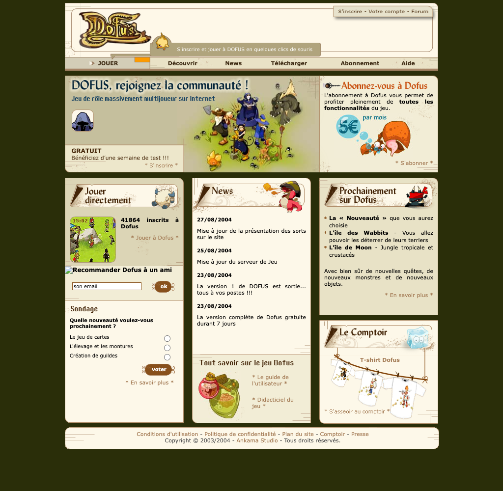
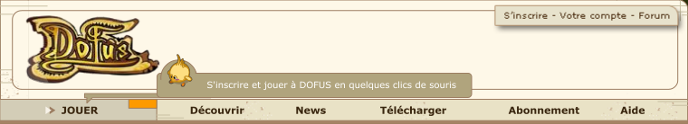

# Project website: the 2004 dofus.com look, and how to rebuild it

Research for a small fan site: a landing page that explains the project, plus a "Jouer" page that centres the 742×550
game canvas and decorates around it. Researched 2026-10-12 from Wayback Machine captures (saved, with provenance
tables, in `vendor/wayback-dofus-site/beta/` and `vendor/wayback-dofus-site/post-beta/`), the beta 5b files in this
repo, and Ankama's published terms. "OBSERVED" = seen in a dated capture; "INFERRED" = deduced, with the reason given.
The project is read here as **non-commercial** (a free fan tribute, no money involved).

## 1. Decisions and summary

Owner decisions (2026-10-12):

- **Design base: dofus.com version 1.0** (launched 23–26 Aug 2004, live until May 2005): parchment cards on a dark
  olive page (§2). The beta-era site (blue/orange, live for beta 5b) is kept as background in §10.
- **Logos:** the gold "Dofus" wordmark is used; the Ankama / Ankama Studio logos are not.
- **Copy:** French, *vous* (as on dofus.com in 2004).
- **Music:** optional on the landing page, off by default (§6).

Summary:

- The site wears the Sep 2004 look while the game is the Jan 2004 beta 5b. Say so once, in the footer (§9).
- **Play page:** the game centred in a parchment frame under the same banner (§7).
- **Legal:** Ankama's current terms forbid using its art and trademarks without written consent, **and** forbid
  decompiling, emulators and protocol emulation (§4). A disclaimer covers attribution and trademarks only.
- **Build:** two static HTML pages in the existing Vite `web/` root, plain CSS, no framework (§8). One unrelated
  blocker for going live: the production build very likely drops the game's dynamically imported scripts (§8.4).

## 2. The chosen design: dofus.com 1.0 (Aug 2004)

OBSERVED: the banner SWF changed between 2004-08-23 06:11 and 2004-08-26 02:04; the new homepage is first captured
2004-08-29 (`post-beta/pages/www.dofus.com_20040829113528.html`), last 2005-05-17. Its own news: "23/08/2004 La version
1 de DOFUS est sortie... tous à vos postes !!!". The render above is a **composite**: the saved HTML and CSS with the
three Flash blocks replaced by JPEXS frame exports (the banner frame is from the 2004-09-16 SWF).

### Layout

From `post-beta/css/d1_basic.css`, `d1_home.css`, `d1_generic.css` (captured 10–15 Sep 2004):

- `body` `#2A2E09`; `* { margin: 0; padding: 0; font-family: Verdana, sans-serif }`.
- `.general`: 765 px, centred, `padding: 5px 0 0 5px`.
- Banner: 760×138 Flash (parchment, logo, Tofu bubble, two tab bars).
- Top row `#hg`: 760×198, `margin-bottom: 10px` = `#flash` 518×197 (left) + `#abo` 242×197 (right).
- Three columns `#bg`, `#bm`, `#bd`: 242 px each, 17 px gaps (3 × 242 + 2 × 17 = 760).
- Footer: 763×51 cream strip (`img/d1_home_footer_simple.gif`), links + "Copyright © 2003/2004 - Ankama Studio - Tous
  droits réservés.", text `#555555`.
- Boxes: rounded corners, 1 px tan edge, each topped by a 242 px title image (71 px tall for big titles).

### Design tokens

| Token | Value | Source |
|---|---|---|
| Page | `#2A2E09` (dark olive) | `d1_basic.css` |
| Banner parchment | `#FEF8E8` | sampled, banner frame |
| Card backgrounds | `#FDF8E9` (cream), `#F2EDD6`, `#E8E2C6`, `#DCD5B6` | `img/d1_home_fond_*` |
| Card edge | `#B4926F` / `#AF8B67`, rounded | `img/d1_home_fond_*`, `d1_basic.css` |
| Title tab | `#DCD5B6` parchment with folded corner, lettering `#432407` | sampled, `d1_home_titre_*.gif` |
| Banner bubble bar | `#B0A47D`, white text | sampled |
| Banner tab bar / active tab | `#E9E2C6` / `#A89F88`, bold dark text | sampled |
| Orange accent (active tab) | `#FD9A00` (≈ the beta-era `#FF9900`) | sampled |
| Links | `#A37A54` 11 px, underline on hover | `d1_generic.css` |
| Buttons | `#88501B` brown pill, white bold text (`fd_bt_voter.gif` 68×24) | `d1_home.css` |
| Inputs | 1 px `#88501B` border, 10 px text, hover/focus `#EEEEEE` | `d1_generic.css` |
| Tables | header `#D5CFAF`, rows `#F3F0E3` / `#E9E5D4`, hover `#CCC7B3` | `d1_generic.css` |
| Message box | 2 px `#88501B` border, bold `#88501B` text | `d1_generic.css` |
| Body text | black, 11 px, justified; `h1` 12 px, `h2` 10 px | `d1_home.css` |
| List bullet | small star `img/d1_etoilem.gif` | `d1_home.css` |

### Fonts and motifs

- Body: `Verdana, Geneva, sans-serif` everywhere (as in 2004).
- Display: **Kharon 4a** (Bold) set the title "DOFUS, rejoignez la communauté !" in `communaute_home.swf` (font name
  from the JPEXS export). DaFont lists Kharon 4a (by Orgdot, before 2005) as free (https://www.dafont.com/kharon4a.font);
  check the licence file in the download before shipping it. The calligraphic lettering of the `titre_*.gif` images is a
  bitmap, font not identified. The banner's "Wide awake" exists only as a partial glyph subset.
- Motifs: parchment cards with rounded corners; title tabs with a folded corner and a monster vignette (a Bouftou-like
  sheep, a red fire creature, a blindfolded black creature); a yellow bird (a Tofu, INFERRED) with a speech bubble in the
  banner; a two-dagger "Loading" preloader; brown pill buttons; star bullets. The banner also showed two random
  characters in a "VS" duel, but those SWFs (`swf/decor.swf`, `swf/perso/*.swf`) were never archived.
- Copy tone: chatty and exclamatory, *vous*: "S'inscrire et jouer à DOFUS en quelques clics de souris", "DOFUS,
  rejoignez la communauté !", "Découvrez un univers sans limite et partez à la recherche des précieux Dofus !", "tous à
  vos postes !!!". Page title: "DOFUS - Jeu de role massivement multijoueur sur Internet".

## 3. Mapping the 1.0 homepage to the project landing

Keep the grid; replace the commercial blocks (subscription, "semaine de test", T-shirt shop) with project content.

| 1.0 block | Size | Project content | Title / art |
|---|---|---|---|
| Banner | 760×138 | Logo; Tofu bubble "Retrouvez la bêta 5b de DOFUS en quelques clics de souris"; top-right tab "Musique" toggle (§6); tabs **JOUER · Découvrir · News · Aide · Crédits** (JOUER → `/jouer.html`, active tab = orange accent) | Rebuilt in HTML/CSS. Tofu, frame and tab shapes can be exported from `post-beta/swf/d1_bandeau_20040916.swf` with `tools/ffdec.sh -export image,shape` |
| `#flash` (hero) | 518×197 | "DOFUS, la bêta 5b est de retour !" (Kharon 4a), subtitle "Jeu de rôle tactique multijoueurs — version bêta du 13 janvier 2004", class group artwork | Game asset `clips/guilds/artwork/big/50.swf/1.png` (766×369, scaled) |
| `#abo` | 242×197 | "Jouer à la bêta 5b": big brown JOUER button → `/jouer.html`, "Gratuit, sans abonnement, dans votre navigateur" | Redrawn title (Kharon 4a on a CSS tab) |
| `#bg` | 242 | **Jouer directement**: 94×94 thumbnail of the port + three steps (s'inscrire, créer un personnage, rejoindre un salon). Below: **Aide** (controls, desktop browser, mouse and keyboard) | Original `titre_jouer.gif`; thumbnail from `port-preview/kernel/08-fight-turn.png` |
| `#bm` | 242 | **News**: dated project journal, by hand. Below: **Tout savoir sur le jeu Dofus**: what beta 5b was, what is original vs reconstituted | Original `titre_new.gif`, `titre_savoir.gif` |
| `#bd` | 242 | **Prochainement sur Dofus**: the port's roadmap. Below: **Crédits** (in place of "Le Comptoir") | Original `titre_proch.gif`; redrawn "Crédits" title |
| Footer | 763×51 + block | Links, era note, disclaimer (§9) | `footer_simple.gif` or CSS |

## 4. Legal constraints (read before choosing assets)

- **No fan-site charter or fan kit exists today.** Ankama Terms of Use v13 (updated Aug 2025,
  https://account.ankama.com/fr/cgu, read 2026-10-12): §13.1 Ankamaverse elements (art, characters, names) and §13.3
  trademarks need prior written consent; §13.2 no copying, decompiling or derived works; §5.2.1 no reverse engineering;
  §5.2.3 no "pirate servers… emulators"; §5.2.6 no protocol emulation. §5.3.3 lets Ankama "authorize, at its sole
  discretion, the dissemination of fan sites" (chat/forum rules, not a licence).
- **2004 precedent (superseded).** The CGU captured 2004-09-15 had a "Sites de Fan" clause: non-commercial use allowed if
  the owner told Ankama by e-mail, made no profit, kept own creations distinct, and put "www.DOFUS.com (c) 2004 Ankama
  Studio. Tous droits réservés." on every page (`post-beta/pages/www.dofus.com_pages_conditions.php_20040915185901.html`).
- **Enforcement on record.** 2010 Arkanic (complaint, two minors held, JeuxOnLine 2010-08-31); 2011 Kay Paradize (TGI
  Lille, suspended sentences, €250,000 to Ankama; Ankama news 18/11/2011); GitHub DMCA notices 2017 (Dofus Touch bots)
  and 2018-02-09 (TouchEmu, a client reimplementation that connected to Ankama's live servers). No public action found
  against 1.29/Retro emulator repos since Dofus Retro launched (24 Sep 2019); several are still on GitHub (an
  observation, not proof of tolerance).
- **Consequence.** A disclaimer handles attribution and trademarks (§13.1, §13.3). It does not address §5.2.x / §13.2,
  which describe the project itself (decompiled client, emulated server); only Ankama's written consent does. Asking
  Ankama first is the only path that removes the risk; that is the owner's call.

## 5. Assets: use, redraw, avoid

Paths: `B/` = `vendor/wayback-dofus-site/beta/`, `P/` = `vendor/wayback-dofus-site/post-beta/`, `M/` =
`web/public/assets/media/bitmaps/` (generated, gitignored). All © Ankama unless stated.

| Asset | Path | Size | Verdict |
|---|---|---|---|
| Gold "Dofus" wordmark (banner bitmap, byte-identical in the Jan 2004 and Sep 2004 banners) | `P/swf-export/logo_dofus_154x84_bandeau.png` | 154×84 | **Use** (decided), at 1× |
| Same wordmark, transparent, from the 2004 press kit | `B/img/dofus.com_pages-presse-kits-dofusbig_20040304.png` | 1000×521 | **Use** for 2× screens and the hero |
| Ankama / Ankama Studio logos | `B/img/dofus.com_pages-presse-kits-ankama*`, `B/img/dofus.com_images-accueil_r5_c1_20030806.gif` | — | **Not used** (decided). Name "Ankama Studio" as text in credits |
| Title tabs "Jouer directement", "News", "Prochainement sur Dofus", "Tout savoir sur le jeu Dofus" | `P/img/d1_home_titre_jouer.gif`, `_new`, `_proch`, `_savoir` | 242×71 / 242×46 | Use as-is (lettering and monster vignette baked in; same footing as the logo) |
| Other titles ("Crédits", "Jouer à la bêta 5b") | — | 242 | Redraw: CSS tab `#DCD5B6`, folded corner, Kharon 4a `#432407` |
| Card backgrounds, footer strip, brown buttons, star bullet | `P/img/d1_home_fond_*`, `footer_simple.gif`, `fd_bt_*.gif`, `d1_etoilem.gif` | small | Use, or redraw in CSS (sharper on 2× screens) |
| Banner frame | `P/swf-export/d1_bandeau_20040916_frame3.png` | 760×138 | Reference only (2004 labels baked in); rebuild |
| Community hero block | `P/swf-export/d1_communaute_home_frame1.png` | 518×197 | Reference only ("GRATUIT, semaine de test" baked in) |
| Crab "5€ par mois", "Le Comptoir" T-shirts, `vignette_jeu.gif` | `P/img/d1_home_crabe.jpg`, `d1_home_comptoir.gif`, `P/swf-export/d1_comptoir_frame1.png`, `P/img/d1_home_vignette_jeu.gif` | — | **Avoid**: commercial, or shows the 1.x interface instead of 5b |
| Class group artwork | `M/clips/guilds/artwork/big/50.swf/1.png` | 766×369 | Use (game asset) in the hero |
| Amakna sky panorama, menu illustrations, trees, spell icons | `M/modules/Interfaces.swf/8.jpg`, `990–995.png`; `M/clips/objects.swf/1235.png` …; `M/clips/spells/icons/<id>.swf/1.jpg` | various | Use (game assets) as decoration |
| Port screenshots | `web/public/assets/port-preview/kernel/02-menu.png`, `03-characters.png`, `06-lobby.png`, `08-fight-turn.png` | 742×550 | Use: our own renders |
| Beta screenshots | `vendor/wayback-dofus-2004/screenshots/booge_wp_04.jpg`, `booge_wp_03.jpg` | ~746×553 | Fan-owned; credit the fan site |
| 2005–2006 looks (foliage logo, chocolate/green) | `P/img/d2c_*`, `d2_*`, `d3_*` | — | Not used (later era) |

`web/public/assets/` is generated and gitignored, so copy the chosen files (~25, under 2 MB with the music) into a
committed `web/public/site/` folder.

**Fonts.** Do not link `/assets/media/fonts.css` from the landing page: it declares `@font-face "Verdana"` with outlines
extracted from the SWFs (Microsoft's font). Use the system stack, plus Kharon 4a (self-hosted `.woff2`) for display
titles. The game page already loads `fonts.css` (`web/src/main.ts:14`), so text around the canvas on that page renders
with the extracted Verdana too.

## 6. Music (optional, off by default)

- A "♪ Musique" toggle in the banner's top-right tab (where 2004 had "S'inscrire - Votre compte - Forum"). Browsers
  block autoplay anyway, so start playback only from that click.
- `<audio src="/site/musique.mp3" loop preload="none">`, `volume` ≈ 0.3 (the game's own music runs at 25–32 %).
- Track: `web/public/assets/media/music/04.mp3` (village theme, 55 s, loops well) rather than `02.mp3` (character
  select, 17 s, repetitive). Both are from the beta 3b music pack (26 Oct 2003); credit them. ~270 KB at 40 kbps.
- Leaving for `/jouer.html` stops it (page change); the game plays its own music.

## 7. The play page

Recommended: the same olive page and banner (JOUER tab active) with the game below it in a parchment frame: cream
`#FDF8E9`, 5 px padding, 1 px `#B4926F` edge, rounded corners; trees or class artwork in the side margins. Historical
alternative: the beta launcher frame (`#203040` page, 2 px white frame, `dofus-5b/lancement.html`); jouer.dofus.com's
entry page kept the `#203040` background until at least Feb 2005 (captures 2004-08-04 → 2005-02-06).

Height budget: banner 138 + 10 + frame 562 ≈ 710 px, more than a 768 px laptop shows. Either CSS-scale the canvas
(`height: min(550px, 100vh - <banner>)`, `aspect-ratio: 742/550`) or use only the 40 px tab bar on this page.

Constraints from the runtime (`web/src/runtime/player.ts`):

- Keyboard is read on `window` (`keydown`/`keyup`, no `preventDefault`): the page must not scroll (space and arrows
  would scroll it) and must not contain other text inputs.
- In-game text fields are real `<input>`/`<textarea>` elements appended to `document.body` with `position:absolute`,
  placed every frame from `canvas.getBoundingClientRect()` plus page scroll, scaled with the canvas. So: keep
  `html`/`body` unpositioned and untransformed, no global `input`/`textarea` styles, nothing stacked over the canvas.
- Mouse mapping and the editor overlay both follow the canvas's CSS size, so CSS scaling is safe. Raising the
  `width`/`height` attributes (e.g. ×2) gives sharp rendering on high-DPI screens with no code change.
- Keep the canvas id `stage`; `?replay=fight` and `?server=` read `location.search` and work from any path.

## 8. Build plan

1. **Pages** (plain HTML + one shared CSS file; no React, no build-time templating). Create `jouer.html` as a copy
   first and replace `index.html` last, when no other work is editing `web/`:
   - `web/index.html` → the **landing page** (§2–§3).
   - `web/jouer.html` → the **game page**: today's `web/index.html` body (canvas + `/src/main.ts`) inside §7.
   - `web/public/site/` → the assets of §5, Kharon 4a, the music.
   → verify: `bun run dev`, open `/`, toggle the music, click JOUER, log in, type in the chat, resize the window.
2. **Multi-page build**: add `web/vite.config.ts` with `build.rollupOptions.input` = `{ index: "index.html", jouer:
   "jouer.html" }` (dev already serves any `.html` under `web/`; `web/runtime-demo.html` works that way).
3. **Docs**: README "Play" says to open `http://localhost:5173`; change to `/jouer.html`.
4. **Before deploying** (separate work, not part of the site):
   - The production build very likely ships without the battlefield/UI scripts: `web/src/game/kernel/boot.ts:31` and
     `kernel/scripts.ts:32` load them only via `import(/* @vite-ignore */ new URL(path, import.meta.url))`, which the
     bundler does not follow, and the `.catch` hides the failure. Not verified (no build was run).
   - Asset URLs are absolute (`/assets/…`, `/lang/fr.json`), so serve from the domain root.
   - An HTTPS page needs `?server=wss://…` or a different default in `web/src/main.ts`.
   - Exclude `web/public/assets/port-preview/` (1.4 GB) from the deploy; regenerate `web/public/assets/` on the host
     with the README scripts.

## 9. Copy

French, *vous*. Facts from `README.md`, `docs/BRIEF.md`, `docs/content-reconstruction.md`:

- **Le projet**: the beta 5b client (13 janvier 2004, Flash 6, 742×550) brought back in the browser, for the testers of
  2003–2004 and for players who never saw it. Free, non-commercial, unofficial.
- **Tout savoir sur le jeu**: a tactical arena game, not yet the MMO: channels, the "Console Multi" lobby, random and
  training fights, 10 *guildes*, max level 30, no monsters, quests or jobs (beta FAQ, late Jan 2004). About 650 external
  testers, ~360 spells (dofus.com, Jan 2004). The last era of the blue interface.
- **Original vs reconstituted**: original client files untouched; lost texts, maps, music and the login screen
  substituted and labelled. Link to `content-reconstruction.md` (per-item provenance).
- **Aide**: desktop browser, mouse and keyboard; S'inscrire the first time, then OK; create a character; join a channel.
- **Crédits**: Ankama Studio (game, art, music); fan screenshots (booge, naholyr, xenografter sites); dofushistory
  (loonaire, CC BY-SA); dofedex; the Internet Archive; Kharon 4a (Orgdot).
- **Era note** (footer): « Habillage inspiré du site dofus.com de septembre 2004 (version 1.0). Le jeu est la bêta 5b
  du 13 janvier 2004. »

Disclaimer (footer, every page):

> Dofus Nostalgie est un projet de fans non officiel, gratuit et non commercial. Il n'est ni affilié à Ankama, ni approuvé
> par Ankama. DOFUS et Ankama sont des marques d'Ankama. Les noms, illustrations, logos et captures de l'univers DOFUS
> présentés ici sont © 2003-2026 Ankama, tous droits réservés, et sont reproduits à titre d'hommage. Nos créations
> originales sont signalées comme telles. Tout élément sera retiré sur simple demande d'Ankama. Jeu officiel :
> www.dofus.com

English version, if the site ever gets one:

> Dofus Nostalgie is an unofficial, free, non-commercial fan project, not affiliated with or endorsed by Ankama. DOFUS
> and Ankama are trademarks of Ankama. All DOFUS names, artwork, logos and screenshots shown here are © 2003-2026
> Ankama, all rights reserved, and are used as a tribute. Our own creations are marked as such, and any element will be
> removed at Ankama's request. Official game: www.dofus.com

Optional period line next to it: "www.DOFUS.com © 2004 Ankama Studio. Tous droits réservés." (the line the 2004
fan-site clause required).

## 10. Background: the other eras

### Beta era (Dec 2003 – Aug 2004): the site live for beta 5b

Full timeline, page list and CSS notes: `vendor/wayback-dofus-site/beta/README.md`.

| Period | Site | Look |
|---|---|---|
| 2003-06-28 | dofus.com placeholder | "DOFUS sera bientôt disponible" |
| 2003-08 → 2003-12 | Old ASP site, jouer.dofus.com tester portal, ASP forum | All blue: body `#37A6DF`, cells `#258DD4`, frames `#0A508E`/`#08518C`, button orange `#FF6533`, links `#FFFFAA`, Verdana 11 px white (`beta/css/dofus.com_style.css_20031202.css`) |
| **2003-12-22 → 2004-08-29** | **New PHP site `index.php?page=…`** (the one live for 5b) | White page, 750 px box with 1 px black border, Flash header: sky blue `#2F9BDA` with the gold logo, orange `#FF9900` nav (S'inscrire · Explorations · Informations · Forums · Bonus · Contacts), grey `#EFEFEF` cards, slanted blue ribbon titles, Verdana 11 px |
| 2004-01 (5b day: 2004-01-13) | Forum still the old ASP one | Old blue skin; CSS captured 2004-01-13 |
| From 2004-02 | `jouer.dofus.com/login.php` | 742×550 Flash on `#203040`, 2 px white frame |

What was live on 13 Jan 2004 (INFERRED, three agreeing observations): the 22/12/2003 news announces "un site tout beau
tout neuf"; the first homepage capture (2004-01-22) still has that item on top; the header SWF captured 2004-01-23 is the
only version before 2004-01-30. The January stylesheet was never archived; 28 of the 37 class/id names in the January
HTML are styled by the 2004-04-23 CSS, which is used as a proxy. The Tofu rollover bubble appears in the 2004-02-13
header SWF; its texts are already in the January SWF.

The image above is a **reconstruction**, not a capture. Real captures with matching CSS:
`beta/renders/dofus.com_index.php_20040516_full.png`, `beta/renders/dofus.com_root_20040727_full.png`.

### Later designs (2005–2006)

Full detail: `vendor/wayback-dofus-site/post-beta/README.md`.

| Design | Dates | Look | Render |
|---|---|---|---|
| Splash + full-Flash site | May 2005 → 2006 | Chocolate `#3A261B`/`#442E21`, cream `#F6F5E9`, green `#0B6A39`/`#127546`, logo in foliage with a bird, "Tactical MMORPG", Eras Demi ITC | `post-beta/renders/d2a_splash_20050718_wayback_1024x768.png` |
| Community portal | Jul 2005 → 2006 | `#3A261B` page, white panels, greens `#00863F`/`#00A755`, sky header with a class line-up, orange footer | `post-beta/renders/dc_communaute_20050727_local_full.png` |
| Language splash | Jun → Dec 2006 | 800×570 image on `#3A261B`, "Ankama Games" by Dec 2006 | `post-beta/renders/d3_splash_20061205_local_1024x768.png` |

## 11. Open decisions

- Ask Ankama for permission before publishing (§4)?
- Play page: parchment frame under the banner (recommended) or the original `#203040` launcher frame (§7)?
- Music track: `04.mp3` (recommended) or `02.mp3` (§6)?
- French only (assumed) or also English?
