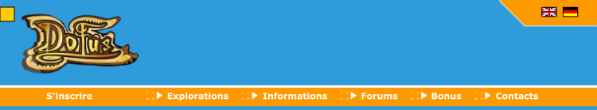
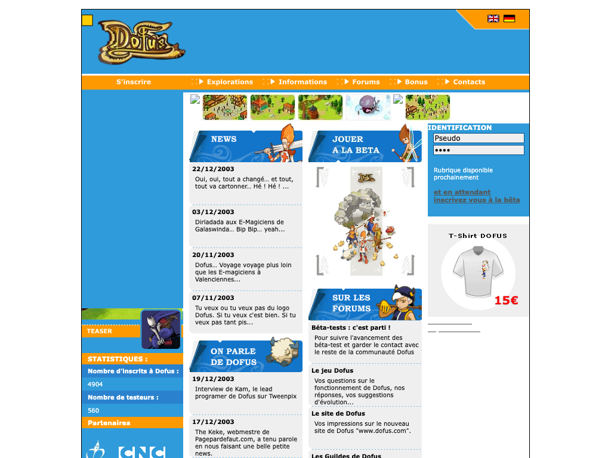

# Project website: what dofus.com looked like in 2004, and how to rebuild that look

Research for a small fan site: a landing page that explains the project, plus a "Jouer" page that centres the 742×550
game canvas and decorates around it. Researched 2026-10-12 from Wayback Machine captures (saved, with provenance
tables, in `vendor/wayback-dofus-site/beta/` and `vendor/wayback-dofus-site/post-beta/`), the beta 5b files in this
repo, and Ankama's published terms. "OBSERVED" = seen in a dated capture; "INFERRED" = deduced, with the reason given.
The project is read here as **non-commercial** (a free fan tribute, no money involved).

## 1. Summary

- **Era.** On 13 Jan 2004 (beta 5b) dofus.com was a **white page with a 750 px box: sky-blue `#2F9BDA` header with the
  gold "Dofus" logo, an orange `#FF9900` nav bar, grey `#EFEFEF` cards, Verdana 11 px**. The parchment-on-dark-olive
  site most players remember is the **1.0 launch site (from 23–26 Aug 2004)**, i.e. post-beta. The beta-era site's blue
  matches the game's own blue interface, so it is the right base, and it is also the period the project recreates.
- **Play page.** Copy the original launcher `dofus-5b/lancement.html`: `#203040` page, 2 px white frame, black box,
  742×550 game, centred. jouer.dofus.com used the same frame in 2004 (`beta/pages/jouer.dofus.com_login.php_20040212.html`).
- **Legal.** Ankama's current terms forbid using its art and trademarks without written consent, **and** forbid
  decompiling, emulators and protocol emulation (§3). A disclaimer covers attribution and trademarks only.
- **Build.** Two static HTML pages in the existing Vite `web/` root, plain CSS, no framework (§7). One unrelated
  blocker for going live: the production build very likely drops the game's dynamically imported scripts (§7.4).

## 2. What the site looked like (beta era)

Full timeline, page list and CSS notes: `vendor/wayback-dofus-site/beta/README.md`.

| Period | Site | Look |
|---|---|---|
| 2003-06-28 | dofus.com placeholder | "DOFUS sera bientôt disponible" |
| 2003-08 → 2003-12 | Old ASP site, jouer.dofus.com tester portal, ASP forum | All blue: body `#37A6DF`, cells `#258DD4`, frames `#0A508E`/`#08518C`, button orange `#FF6533`, links `#FFFFAA`, Verdana 11 px white (`beta/css/dofus.com_style.css_20031202.css`) |
| **2003-12-22 → 2004-08-29** | **New PHP site `index.php?page=…`** (the one live for 5b) | White page, 750 px box, Flash header, blue/orange (below) |
| 2004-01 (5b day: 2004-01-13) | Forum still the old ASP one, at `forum.dofus.com` and `ankama-studio.com/forumdofus/` | Old blue skin; CSS captured 2004-01-13 |
| 2004-02-02 | New forum | Same frame as the main site (CSS only archived from 2004-04-13) |
| From 2004-02 | `jouer.dofus.com/login.php` | 742×550 Flash on `#203040`, 2 px white frame |

**What was live on 13 Jan 2004** (INFERRED, three agreeing observations): the 22/12/2003 news announces "un site tout beau
tout neuf"; the first homepage capture (2004-01-22) still has that item on top; the header SWF captured 2004-01-23 is
the only version before 2004-01-30. The 2004-01-28 HTML even links a `style_130104.css` (13/01/04) in a comment.

### Layout of the 2004 homepage

The January 2004 stylesheet was never archived. The January HTML uses 37 class/id names; 28 of them are styled in the
2004-04-23 CSS (`beta/css/dofus.com_style.css_20040423.css`), so that CSS is a close proxy (INFERRED).

- OBSERVED in January: header Flash 750×139 (HTML attributes); header blue `#2F9BDA`, orange nav `#FF9900`, gold logo,
  UK/DE flags, "VS" medallion (SWF export); nav **S'inscrire · Explorations · Informations · Forums · Bonus · Contacts**;
  left column with teaser (170×72 Flash), STATISTIQUES (inscrits 4904, testeurs 560), Partenaires.
- From the April CSS: `.centreur` margin-top 15 px, text centred; `.general` 750 px, `margin: 0 auto`, 1 px black border;
  Verdana 11 px (10 px in cards).
- Columns (from asset widths and the reconstruction): left 170 px blue column, two 190 px content columns, right 170 px
  column (IDENTIFICATION form, T-shirt).
- Boxes: NEWS, ON PARLE DE DOFUS, **JOUER A LA BETA**, SUR LES FORUMS, IDENTIFICATION, COMPTOIR DE DOFUS,
  STATISTIQUES, Partenaires, TEASER.
- Footer: "D O F U S 2003/2004 - Ankama Studio - Tous droits réservés."

The image above is a **reconstruction**, not a capture: the January HTML rendered with the April CSS and the March/April
`.gif` ribbon titles (January used `.jpg` versions that were not archived). Real captures with matching CSS:
`beta/renders/dofus.com_index.php_20040516_full.png`, `beta/renders/dofus.com_root_20040727_full.png`.

### Design tokens for the beta-era look

| Token | Value | Source |
|---|---|---|
| Page | `#FFFFFF` | Apr 2004 CSS |
| Box | 750 px, 1 px solid black, centred, 15 px from top | Apr 2004 CSS |
| Main blue (header, left column, inner menus) | `#2F9BDA` | Jan 2004 header SWF + Apr CSS |
| Orange (nav, box titles, footer, content links) | `#FF9900` | Jan 2004 header SWF + Apr CSS |
| Ribbon titles / sub-title blue | `#1275CA` / `#2A82CE` | Apr CSS |
| Inner sub-menu | `#57AEE1` | Apr CSS |
| Cards | `#EFEFEF`, rounded left edge, dotted blue separators | Apr CSS + `img/dofus.com_img-bordure_fenetre`, `point_bleu` |
| Text | `#444` / `#555` / `#666` | Apr CSS |
| Input border | `#08518C` | Apr CSS |
| Logo golds / outline / brown | `#EAC74C`, `#EFD68E` / `#0C0604` / `#62351F` | logo bitmap |
| Type | `Verdana, Geneva, sans-serif` 11 px; bold white on orange/blue bars | Apr CSS |

Motifs: slanted blue 190×65 ribbon titles, each with a character cut-out; grey cards with a rounded left edge; orange
pill buttons (70×21); a strip of 76×44 screenshot thumbnails; the "VS" medallion (the header showed two random
characters facing off, but those character SWFs were never archived). The Tofu speech bubble in the header dates from
the **2004-02-13** SWF (beta 6b era), not January.

Copy tone (OBSERVED): French; the main site says *vous* ("Inscrivez vous maintenant à Dofus !"), the tester portal and
`dofus-5b/LIS-MOI.txt` say *tu* ("Accéder à ton compte"). News titles riff on French pop songs ("Oui, oui, tout a
changé et tout, tout va cartonner… Hé ! Hé !", "Voyage voyage…"). Taglines: "Jeu de rôle tactique multijoueurs",
"Seul ou à plusieurs, découvrez un univers sans limite", "partez à la recherche des 6 précieux Dofus".

## 3. Legal constraints (read before choosing assets)

- **No fan-site charter or fan kit exists today.** Ankama Terms of Use v13 (updated Aug 2025,
  https://account.ankama.com/fr/cgu, read 2026-10-12): §13.1 Ankamaverse elements (art, characters, names) and §13.3
  trademarks need prior written consent; §13.2 no copying, decompiling or derived works; §5.2.1 no reverse engineering;
  §5.2.3 no "pirate servers… emulators"; §5.2.6 no protocol emulation. §5.3.3 lets Ankama "authorize, at its sole
  discretion, the dissemination of fan sites" (chat/forum rules, not a licence).
- **2004 precedent (superseded).** The CGU captured 2004-09-15 had a "Sites de Fan" clause: non-commercial use allowed if
  the owner told Ankama by e-mail, made no profit, kept own creations distinct, and put "www.DOFUS.com (c) 2004 Ankama
  Studio. Tous droits réservés." on every page (`post-beta/pages/www.dofus.com_pages_conditions.php_20040915185901.html`).
- **Enforcement on record.** 2010 Arkanic (complaint, two minors held, JeuxOnLine 2010-08-31); 2011 Kay Paradize (TGI
  Lille, suspended sentences, €250,000 to Ankama; Ankama news 18/11/2011); GitHub DMCA notices 2017 (Dofus Touch bots)
  and 2018-02-09 (TouchEmu, a client reimplementation that connected to Ankama's live servers). No public action found
  against 1.29/Retro emulator repos since Dofus Retro launched (24 Sep 2019); several are still on GitHub (an
  observation, not proof of tolerance).
- **Consequence.** A disclaimer handles attribution and trademarks (§13.1, §13.3). It does not address §5.2.x / §13.2,
  which describe the project itself (decompiled client, emulated server); only Ankama's written consent does. Asking
  Ankama first is the only path that removes the risk; that is the owner's call.

## 4. What most players remember (post-beta, label as such if used)

Full detail: `vendor/wayback-dofus-site/post-beta/README.md`.

| Design | Dates | Look | Render |
|---|---|---|---|
| 1.0 launch site | banner swapped 23–26 Aug 2004 → May 2005 | Dark olive page `#2A2E09`, cream parchment cards `#FDF8E9`, tan borders `#B4926F`, brown calligraphic title tabs with monster vignettes, buttons `#88501B`; nav JOUER · Découvrir · News · Télécharger · Abonnement · Aide; "5€ par mois", "semaine de test" | `post-beta/renders/d1_home_20040829_COMPOSITE_flash-frames_full.png` (reconstructed from Flash frames) |
| Splash + full-Flash site | May 2005 → 2006 | Chocolate `#3A261B`/`#442E21`, cream `#F6F5E9`, green `#0B6A39`/`#127546`, logo in foliage with a bird, "Tactical MMORPG" | `post-beta/renders/d2a_splash_20050718_wayback_1024x768.png` |
| Community portal | Jul 2005 → 2006 | `#3A261B` page, white panels, greens `#00863F`/`#00A755`, sky header with a class line-up, orange footer | `post-beta/renders/dc_communaute_20050727_local_full.png` |

Usable for a beta page without a label: the **gold wordmark** (byte-identical bitmap in the Jan 2004 and Sep 2004
headers) and the tagline "Jeu de rôle massivement multijoueur sur Internet" (page title by Jul 2004). Everything else
in this table (parchment, olive, chocolate/green, monster vignettes, subscription copy) is 1.x and should carry a
"version 1.0, 2004–2005" caption if it appears, e.g. in a "then vs. later" strip.

## 5. Assets: reuse, redraw, avoid

Paths: `B/` = `vendor/wayback-dofus-site/beta/`, `P/` = `vendor/wayback-dofus-site/post-beta/`, `M/` =
`web/public/assets/media/bitmaps/` (generated, gitignored). All © Ankama unless stated.

| Asset | Path | Size | Verdict |
|---|---|---|---|
| Official logo, transparent (from the 2004 **press kit**, i.e. handed out for reuse at the time) | `B/img/dofus.com_pages-presse-kits-dofusbig_20040304.png` | 1000×521 | Reuse with credit (owner's call) |
| Gold logo from the header | `B/swf-export/bandeau_20040123/images/22.png` | 154×84 | Same |
| Jan 2004 header (static parts) | `B/swf-export/bandeau_20040123/frames/2.png` | 750×139 | Reference; rebuild in HTML/CSS around the logo |
| Ribbon titles NEWS / ON PARLE / JOUER A LA BETA / SUR LES FORUMS | `B/img/dofus.com_img-titre_*_20040331.gif` | 190×65 | Character art inside → reuse with credit, or redraw the ribbon shape without characters |
| Card edge, dotted separator, pill button | `B/img/dofus.com_img-bordure_fenetre*`, `point_bleu*` (files captured 2005, names referenced by the 2004 CSS), `btvalider*` | small | Redraw in CSS (rounded corner, `border-bottom: 1px dotted`, pill) |
| Amakna sky panorama (game menu background) | `M/modules/Interfaces.swf/8.jpg` | 742×550 | Reuse (game asset): landing hero or play-page backdrop |
| Menu illustrations (fighters, catapult, books…) | `M/modules/Interfaces.swf/990–995.png` | ~100–154 px | Reuse as section icons |
| Four-class group artwork | `M/clips/guilds/artwork/big/50.swf/1.png` | 766×369 | Reuse (landing hero) |
| Trees (margin decorations) | `M/clips/objects.swf/1235.png`, `1238.png`, `687.png`, `654.png` | 103–215 px | Reuse around the game frame |
| Spell icons | `M/clips/spells/icons/<id>.swf/1.jpg` | 40×40 | Reuse sparingly (bullets) |
| Port screenshots | `web/public/assets/port-preview/kernel/02-menu.png`, `03-characters.png`, `06-lobby.png`, `08-fight-turn.png` | 742×550 | Reuse: these are our own renders |
| Beta screenshots | `vendor/wayback-dofus-2004/screenshots/booge_wp_04.jpg` (4b fight), `booge_wp_03.jpg` (lobby) | ~746×553 | Fan-owned; credit the fan site |
| Palette, layout, Verdana, ribbon/card/pill shapes | — | — | Redraw freely: design language, not assets |
| 1.x monster vignettes, parchment tabs, subscription copy | `P/img/d1_home_titre_*.gif` etc. | — | Avoid, or label as 1.x |

`web/public/assets/` is generated and gitignored, so copy the chosen files (~20, under 2 MB) into a committed
`web/public/site/` folder.

**Fonts.** Do not link `/assets/media/fonts.css` from the landing page: it declares `@font-face "Verdana"` with outlines
extracted from the SWFs (Microsoft's font). Use the system stack `Verdana, Geneva, sans-serif`. The header's "Wide awake"
font exists only as a partial glyph subset (`B/swf-export/bandeau_20040123/fonts/`); don't build on it. `bitMini6`
(the game's 8 px pixel font) is the only embeddable candidate, origin unknown. The game page itself already loads
`fonts.css` (`web/src/main.ts:14`), so text around the canvas on that page renders with the extracted Verdana too.

## 6. The play page

Model: `dofus-5b/lancement.html` (and `jouer.dofus.com/login.php`, Feb 2004): body `#203040`, table centred
horizontally and vertically, 2 px white frame, black box, 742×550 movie, `scroll=no`.

Decorations around it, in the **margins only**: a slim 2004 header (logo on `#2F9BDA` + orange nav "Accueil · Le projet
· Crédits"), trees or class artwork at the sides, a one-line footer. Constraints from the runtime
(`web/src/runtime/player.ts`):

- Keyboard is read on `window` (`keydown`/`keyup`, no `preventDefault`): the page must not scroll (space and arrows
  would scroll it) and must not contain other text inputs.
- In-game text fields are real `<input>`/`<textarea>` elements appended to `document.body` with `position:absolute`,
  placed every frame from `canvas.getBoundingClientRect()` plus page scroll, scaled with the canvas. So: keep
  `html`/`body` unpositioned and untransformed, no global `input`/`textarea` styles, nothing stacked over the canvas.
- Mouse mapping and the editor overlay both follow the canvas's CSS size, so the canvas may be CSS-scaled (for example
  `height: min(550px, 100vh - <header>)` with `aspect-ratio: 742/550`) to fit 768 px-tall laptop screens. Raising the
  `width`/`height` attributes (e.g. ×2) gives sharp rendering on high-DPI screens with no code change.
- Keep the canvas id `stage`; `?replay=fight` and `?server=` read `location.search` and work from any path.

## 7. Build plan

1. **Pages** (plain HTML + one CSS file each; no React, no build-time templating):
   - `web/index.html` → the **landing page** (2004 frame: 750 px box, blue header with the logo, orange nav, grey
     cards). Its main call to action is an orange "JOUER A LA BETA" box/button linking to `/jouer.html`.
   - `web/jouer.html` → the **game page**: today's `web/index.html` body (canvas + `/src/main.ts`) inside the
     `lancement.html` frame and margin decorations of §6.
   - `web/public/site/` → the curated assets of §5.
   → verify: `bun run dev`, open `/`, click through to `/jouer.html`, log in, type in the chat, scale the window.
2. **Multi-page build**: add `web/vite.config.ts` with `build.rollupOptions.input` = `{ index: "index.html", jouer:
   "jouer.html" }` (dev already serves any `.html` under `web/`; `web/runtime-demo.html` works that way).
3. **Docs**: README "Play" says to open `http://localhost:5173`; change to `/jouer.html`.
4. **Before deploying** (separate work, not part of the site):
   - The production build very likely ships without the battlefield/UI scripts: `web/src/game/kernel/boot.ts:31` and
     `kernel/scripts.ts:32` load them only via `import(/* @vite-ignore */ new URL(path, import.meta.url))`, which the
     bundler does not follow, and the `.catch` hides the failure. Not verified (no build was run).
   - Asset URLs are absolute (`/assets/…`, `/lang/fr.json`), so serve from the domain root.
   - An HTTPS page needs `?server=wss://…` or a different default in `web/src/main.ts`.
   - Exclude `web/public/assets/port-preview/` (1.4 GB) from the deploy; regenerate `web/public/assets/` on the host
     with the README scripts.

## 8. Copy

Suggested landing sections (French first; facts from `README.md`, `docs/BRIEF.md`, `docs/content-reconstruction.md`):

1. **Header line**: "Dofus — version bêta 5b, 13 janvier 2004". Optional nod: the ASCII banner from `LIS-MOI.txt`.
2. **Le projet**: the beta 5b client (Flash 6, 742×550) brought back in the browser, for the testers of 2003–2004 and for
   players who never saw it. Free, non-commercial, unofficial.
3. **Ce qu'était la bêta 5b**: a tactical arena game, not yet the MMO: channels, the "Console Multi" lobby, random and
   training fights, 10 *guildes*, max level 30, no monsters, quests or jobs (beta FAQ, late Jan 2004). About 650 external testers,
   ~360 spells (dofus.com, Jan 2004). Last era of the blue interface.
4. **Ce qui est d'origine, ce qui est reconstitué**: original client files untouched; lost texts, maps, music and the
   login screen substituted and labelled. Link to `content-reconstruction.md` (per-item provenance).
5. **Jouer**: the button, plus a note that the game needs a desktop browser with mouse and keyboard (742×550).
6. **Crédits**: Ankama Studio (game, art, music); fan screenshots (booge, naholyr, xenografter sites); dofushistory
   (loonaire, CC BY-SA); dofedex; the Internet Archive.

Address: the 2004 site said *vous*; the tester portal and `LIS-MOI.txt` said *tu*. *Tu* suits a page written for former
testers; pick one and keep it.

Disclaimer (footer, every page):

> Dofus Nostalgie est un projet de fans non officiel, gratuit et non commercial. Il n'est ni affilié à Ankama, ni approuvé
> par Ankama. DOFUS et Ankama sont des marques d'Ankama. Les noms, illustrations, logos et captures de l'univers DOFUS
> présentés ici sont © 2003-2026 Ankama, tous droits réservés, et sont reproduits à titre d'hommage. Nos créations
> originales sont signalées comme telles. Tout élément sera retiré sur simple demande d'Ankama. Jeu officiel :
> www.dofus.com

> Dofus Nostalgie is an unofficial, free, non-commercial fan project, not affiliated with or endorsed by Ankama. DOFUS
> and Ankama are trademarks of Ankama. All DOFUS names, artwork, logos and screenshots shown here are © 2003-2026
> Ankama, all rights reserved, and are used as a tribute. Our own creations are marked as such, and any element will be
> removed at Ankama's request. Official game: www.dofus.com

Optional period footer next to it: "www.DOFUS.com © 2004 Ankama Studio. Tous droits réservés." (the line the 2004
fan-site clause required).

## 9. Open decisions

- Use the official logo and ribbon-title character art (credited), or redraw everything except game assets?
- Ask Ankama for permission before publishing (§3)?
- *Tu* or *vous*; French only, or French + English?
- Optional music on the landing page (`web/public/assets/media/music/02.mp3`, the character-select theme, 17 s, from the
  beta 3b pack), off by default.
